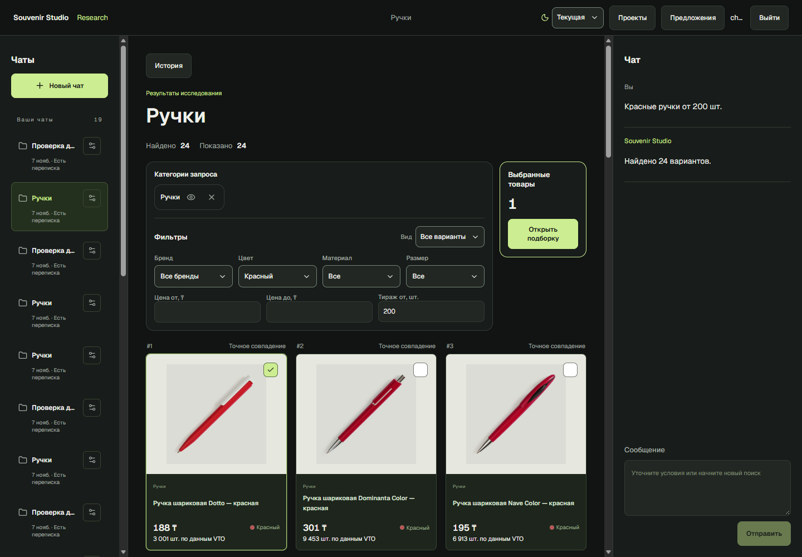
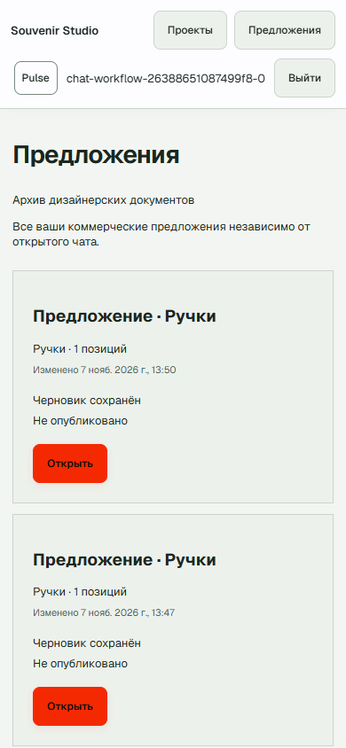
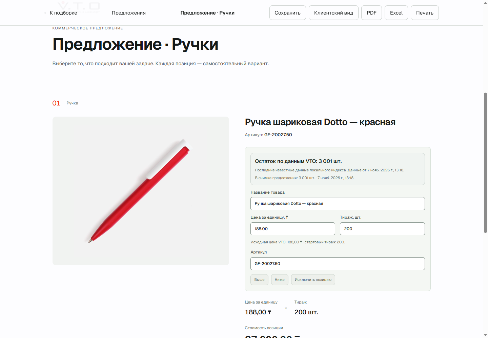

# Чаты, постоянная переписка и навигация предложений

Локальная приёмка: 7 ноября 2026 года. Основная заполненная PostgreSQL,
существующий HTTP API, production frontend и установленный Microsoft Edge.
Chromium и новые браузерные зависимости не устанавливались.

## Причина исчезновения сообщений

**PASS — причина воспроизведена.** В одном тестовом чате после двух поисков
SQL содержал четыре Message, а активный Research возвращал две записи в
`research.messages`. Правая панель читала именно этот массив. Замена активного
поиска меняла видимый разговор, хотя прежние SQL-записи оставались.
[Измерение до исправления](screenshots/chat-workflow/before.json).

Теперь источники разделены:

`User → Project → Chat/Message/ConversationTurn` — переписка;
`Project → ProjectQuery → Research/revisions` — единственная активная выдача;
`Project → ProjectCollection → CommercialOffer/revisions` — выбор и документ.

История читается из Message по доказанному chat_id и владельцу, без фильтра
active_query_id. Старые записи не копировались из research и не объединялись
по сходству названий. Физически отсутствующий текст не реконструируется.
Проверены все 60 прежних сообщений: исходные значения сохранены.

## Создание, название и сохранение

«Новый чат» сразу создаёт серверный проект и чат без формы названия, со своей
пустой подборкой. Предложение автоматически не создаётся. UUID создания и
уникальность `(user_id, creation_key)` защищают повтор HTTP; кнопка блокирует
одновременный create. После успешного создания следующее нажатие получает новый
UUID. Ошибка сохраняет прежний workspace и ключ для повтора.

Короткое имя берётся из разобранного intent: «Ручки», «Ручки, блокноты и кепки»,
«Мерч для IT-конференции». Для длинного перечня показываются первые категории
и число остальных; для discovery используется пользовательское назначение.
Дополнительного обращения к Qwen ради имени нет. Неопознанный смысл оставляет
нейтральное название. `name_source/name_version` и условное обновление защищают
ручное имя; последующие поиски его не меняют. Старые имена мигрированы как manual.

ConversationTurn фиксирует request_id, epoch, исходное сообщение, ответ,
research/query/revision, статус и ошибку. Пользовательский Message коммитится
до планирования поиска. Успех, отказ, отмена и проигрыш гонки сохраняют собственный
ответ. Повтор принятого request_id не запускает поиск повторно и не создаёт
дубликат; иной текст с тем же ID отклоняется. Сохранённый терминальный отказ
остаётся отказом при повторе этого ID; отредактированное сообщение имеет новый ID.

Запоздалый поиск сохраняется как архивный результат и не заменяет новый active
workspace. Серверные epoch/CAS и frontend generation/revision guards сохранены.
Принятый запрос, оставшийся без исполнителя после остановки процесса, при чтении
истории старше пяти минут получает явный INTERRUPTED, а не выдуманный результат.
Восстановление ограничено 50 операциями за чтение. Это восстановление состояния,
не автоматический повтор поиска.

До подтверждения UI пишет «Отправляю», а не «сохранено». Текст и request_id
черновика сохраняются на вкладке; ответ прежней операции не стирает уже введённый
следующий текст. Серверная история восстанавливается после F5 и рестарта API.

## История и интерфейс

`GET /api/chats/{id}/history` возвращает последние 50 сообщений, максимум 100
по параметру, со стабильным курсором `(created_at,id)`, привязанным к чату.
Предусмотрены отдельные before/after страницы; неправильный курсор отклоняется.
Контекст LLM и отображаемая история не зависят друг от друга.

Дозагрузка старой страницы сохраняет DOM-якорь. Когда пользователь читает выше,
новый ответ не перемещает его вниз: появляется «К новым сообщениям». В Edge
проверена изолированная синтетическая история из 140 явно тестовых сообщений:
50 → 100 и новый настоящий поисковый turn. Это не восстановленные сообщения клиента.

На пустом экране одно центральное поле; после начала разговора — одно поле
продолжения справа либо в мобильной панели. Используется общий controlled composer.
Удалены постоянный прогресс каталога, три подсказки, списки документов и архив
дизайнера из поиска. Пользовательские сообщения с похожими словами остаются;
технические записи скрываются только по типу/происхождению. Команды фильтрации
по-прежнему можно написать самостоятельно.

## Предложения и остатки

Navbar «Предложения» открывает `/offers`: все коммерческие документы владельца
из всех чатов, одна строка на документ, ограниченная курсорная пагинация по
updated_at/id. В списке название, чат, число позиций, дата, отдельные состояния
черновика/публикации/срока. Нет общей суммы. Два пакетных SQL-чтения дают summaries
и компактную информацию ревизий; полные документы и отдельные polling для строк
не загружаются. Чтение списка не ставит render jobs.

List DTO не содержит ключей, storage paths или складских данных. Ссылка запрашивается
отдельным owner-only действием копирования, только когда она доступна и готова.
PDF/Excel доступны по существующим READY-ревизиям. Старые коммерческие дубликаты
сохраняются как предыдущие документы. Архив дизайнера вынесен в `/offers/archive`;
его прежние документы и совместимые маршруты сохранены.

Из подборки, navbar и прямого URL открывается тот же основной offer ID.
Ручная цена, тираж, порядок, исключения и настройки не обновляются из каталога
при открытии. Изменение состава остаётся явным действием.

Owner-only `owner_stock` пакетно читает последние ProductObservation точных offer IDs
из локальной PostgreSQL. Вызовов VTO для каждой позиции нет. Отдельно показаны
последний известный остаток с датой и остаток снимка документа. Ноль остаётся нулём,
NULL — «Количество не указано», incoming выводится отдельно. При отсутствии
индекса помечается SNAPSHOT_ONLY. Нет часового freshness gate, суммирования цветов,
складской географии или недоказанного «свободного» остатка. Превышение тиража даёт
предупреждение, не меняет ввод и не создаёт резерв.

Публичный ClientOffer не получает owner_stock. Реальные гостевые JSON, DOM,
PDF/XLSX проверены отдельно; экспорты по hash совпали после рестарта. Складские
owner-подписи и поля в них отсутствуют. Цена и тираж предложения остаются видимыми.
Обновление owner-stock не переписывает snapshot или готовые экспорты.

## Четырнадцать дней

Одна серверная константа LINK_LIFETIME_DAYS=14 определяет worker/API; UI читает
`share.lifetime_days`. Новая ссылка получает `activated_at + 14×24 часа` после
первого READY. Очередь, чтение, копирование, сохранение и обновление публикации
не начинают новый срок. Истечение закрывает публичные данные, photos и downloads,
но оставляет документ владельцу. Явный повторный выпуск использует тот же документ
и новый ключ; старый ключ не оживает от запоздалого worker.

Совместимая миграция **0026_chat_workflow** добавляет provenance имени,
идемпотентность создания, operation_id, таблицу turn и индекс курсора сообщений.
Не заменяет исторические чаты или документы. Повторяемая TTL data-функция продлевает
только ещё действующие доказанные семидневные интервалы от исходной активации.
На основной БД две такие ссылки получили 14 дней. Третья, с консервативно
восстановленной активацией, сохранила прежнюю конечную границу — новой даты ей
не приписывали. Истёкшие/отозванные ссылки не продлеваются; некорректные активные
даты требуют явного перевыпуска. Невалидных активных дат в live-проверке нет.
Граничные времена проверялись управляемыми часами тестов, без изменения системной
даты или сроков настоящих документов.

## Приёмка и ограничения

| Проверка | Результат | Статус |
|---|---|---|
| Основной HTTP + PostgreSQL | 24 проверки: пять запросов/уточнений → 10 сообщений, retry, история, изоляция, collection, основной editor, READY и экспорты | PASS |
| Параллельный HTTP + PostgreSQL | Два пользователя; duplicate → один turn, одинаковый key у разных пользователей независим; старый запрос 409, новый 202, шесть сообщений и новая сетка сохранены | PASS |
| Перезапуск API | История, подборка, ручная цена 35224.51/тираж 77, тот же link/revision/expiry и hashes файлов | PASS |
| Edge | 20 проверок: desktop 1440×1000, mobile 390×844, Current/Pulse, F5, панель выбора, owner/guest и прокрутка | PASS |
| Полный backend suite | 630 passed, 1 opt-in deselected; 305.39 s | PASS |
| Финальные conversation/migration/lifecycle regressions | 20 passed; 18.85 s; включая pending retry, INTERRUPTED, malformed cursor и состояние sidebar | PASS |
| Frontend suite | 70 passed | PASS |
| Ruff / ESLint / TypeScript / production build / diff --check | Выполнены | PASS |
| Внешний Vercel / HTTPS / другая сеть | Не выполнялись; вход/deploy не использовались | NOT TESTED |
| Native Excel, длительный load/p95, все браузеры/screen reader | Не выполнялись в этой итерации | NOT TESTED |

[HTTP](screenshots/chat-workflow/http.json) ·
[Concurrency](screenshots/chat-workflow/concurrency.json) ·
[Edge](screenshots/chat-workflow/browser.json) ·
[Restart и fingerprints](screenshots/chat-workflow/restart-preservation.json).

Пять последовательных локальных чтений перед очисткой: медиана истории **8.33 ms**,
списка предложений **10.61 ms**. Параллельный HTTP smoke занял **4.665 s**.
Это небольшие локальные измерения, не p95 и не оценка полной пропускной способности.
Лимиты, число workers и rate limits не повышались. Новая бесконечная загрузка
истории, per-card VTO lookup и отдельная очередь не добавлялись.

Промежуточные отказы не считались успешной приёмкой. Исправлены: порядок flush
ResearchRecord перед архивным FK при позднем ответе; защищённый путь архива;
проверка коммерческих полей отдельно от служебной подготовки assets. В браузерном
сценарии исправлены повторная установка старого chat ID при F5, CDP target и слишком
ранний снимок до загрузки сетки. На реальном mobile устранено перекрытие navbar
и заголовка списка. Последние снимки сделаны после этих исправлений.

## Скриншоты

Остальные состояния: [Current mobile](screenshots/chat-workflow/chat-current-mobile.png),
[Pulse desktop](screenshots/chat-workflow/chat-pulse-desktop.png),
[предложения Current](screenshots/chat-workflow/offers-current-desktop.png),
[якорь истории](screenshots/chat-workflow/history-anchor.png),
[гостевой экран](screenshots/chat-workflow/guest.png).

## Сохранность и воспроизведение

До проверки: 3 реальных пользователя, 3 проекта, 60 сообщений, 17 позиций подборок,
16 документов, 20 ревизий. Fingerprints исходных бизнес-полей совпали после
изменений и рестарта; encryption key сохранил SHA-256. Из старых share metadata
изменены только два разрешённых expires_at. Исходные snapshots не перерендеривались.

В начале было 9317 SupplierOffer, при контрольном чтении — 9820. Рост относится
к существующему VTO worker. Код импортера, stock policy, observations и checkpoint
не исправлялись этой задачей; полного покрытия VTO здесь не заявляется.
В контрольный момент job находился в собственном backoff VTO_HTTP_ERROR на page 40.
Аккаунты/каталог не сбрасывались. Физические hashes всех старых assets отдельно
не измерялись; очистка ограничена каталогами созданных тестовых документов.

Постоянные scripts: `scripts/check_chat_workflow.py prepare → deploy → run → race →
browser → restart → verify → cleanup`; `deploy` применяет обычный Alembic upgrade.
Frontend перед `web` нужно собрать. Ledger в `.local` содержит cookies/ключи и не
коммитится. Cleanup проверяет ownership, exact IDs и исходные fingerprints до
удаления; общие фото, logos, storage key и прежние документы остаются.
Очистка выполнена: удалены по точным ID **2 тестовых пользователя, 20 тестовых
проектов и 10 тестовых документов** с их собственными render directories. Повторы
браузерного сценария входили в этот ledger. После удаления fingerprints прежних
данных снова совпали. Временный профиль Edge и listener 9226 закрыты, ledger с
cookies/ключами удалён. Постоянные регрессии и скриншоты сохранены.
[Финальная проверка](screenshots/chat-workflow/cleanup.json).

API, frontend и его API proxy после очистки возвращают HTTP 200. PostgreSQL,
Ollama, API и frontend оставлены работающими. Внешний deployment этой версии
интерфейса не выполнялся.
