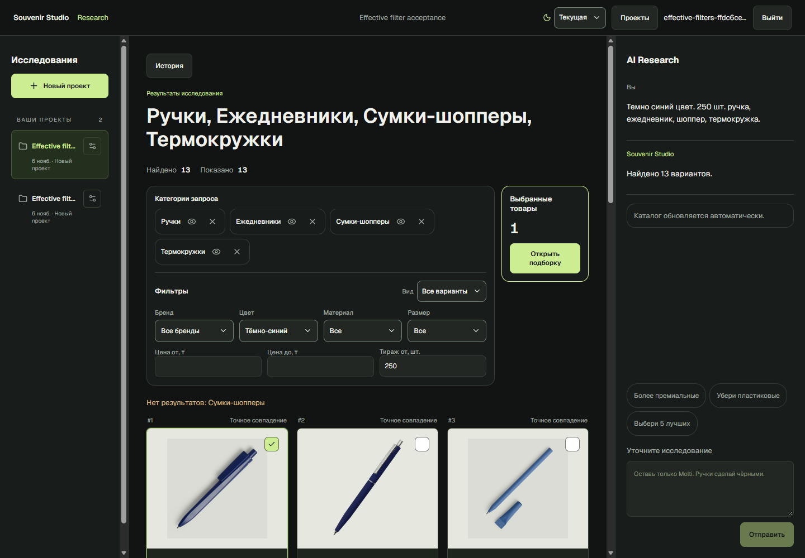
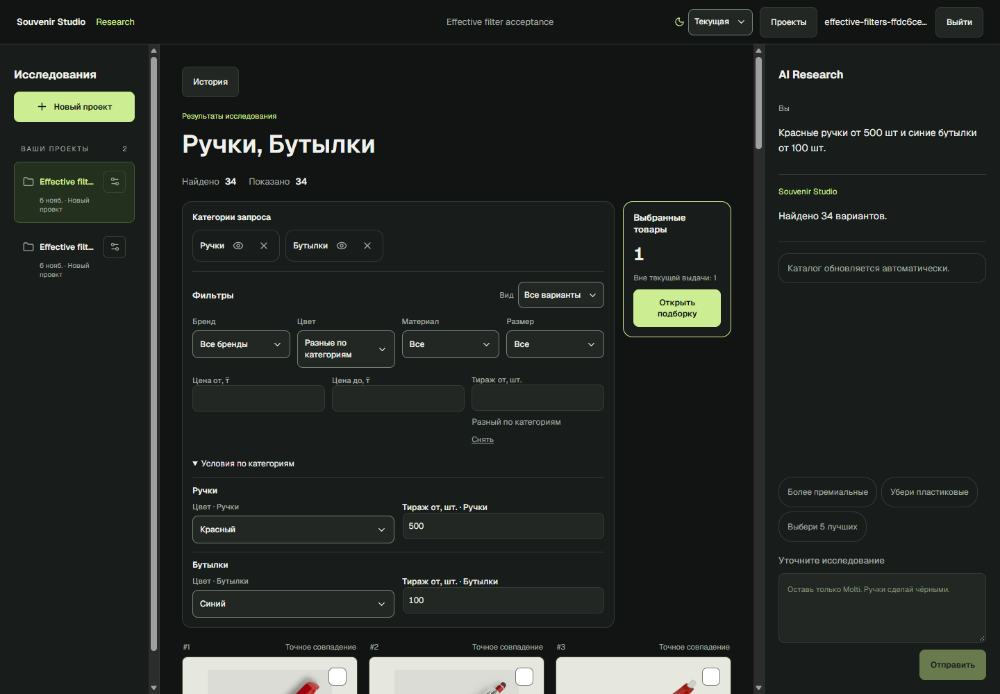

# Категории и действующие фильтры

6 ноября 2026 года. Реализованы серверная проекция условий и редактирование через существующий revisioned ResearchView. Парсер, импорт VTO, stock policy, авторизация и PDF pipeline в этой задаче не изменялись. Существующие незакоммиченные изменения предыдущих задач сохранены.

## Причины и исправление

Раньше `ResearchFilterPanel` читал числовые поля, материал, размер и бренд преимущественно из `view.filters`, то есть дополнительных ограничений. Требования исходного запроса оставались в intent/ветках. Для цвета существовала отдельная проекция `color_state`, но общего механизма для остальных полей не было. Плашки категорий одновременно выводили условия, счётчики и исходный фрагмент в tooltip.

Теперь `effective_filters` вычисляется сервером из копии сохранённого intent, явных view overrides и дополнительных фильтров. Используются **все оставшиеся ветки**, включая скрытые и ветки без результатов. Удалённые ветки исключаются. Страница карточек и facet counts не определяют значения полей.

Для каждого поля сервер возвращает `none`, `common`, `mixed`, `complex` или `conflict`, реальные значения, числовую границу и признак строгого сравнения. Условия OR/AND не сворачиваются в один случайный вариант; сложные пересечения и несовместимые границы поясняются. Модель, исключения, ёмкость, SKU, верхняя граница количества и прочие технические требования остаются внутри фильтров.

Категорийные плашки содержат только название и действия. Счётчики остаются в строке «Найдено / Показано». Порядок, branch IDs, hide/show/remove и правый блок выбранных сохранены.

## Изменение и сброс

`PATCH /api/researches/{id}/view` принимает `effective_changes` с полем, действием `set`, `clear` или `inherit` и необязательным `branch_id`. Это совместимое расширение существующего состояния и механизма версий, без миграции БД.

- `set` заменяет действующее условие соответствующего поля.
- `clear` явно снимает его, включая исходное ограничение; пустое поле не оставляет скрытого AND.
- `inherit` возвращает требование сохранённого intent.
- Общий сброс дополнительных фильтров удаляет overrides и возвращает исходные условия текущей принятой ревизии запроса.

Базовый intent и исходное сообщение не переписываются ради заполнения controls. Ответ показывает вычисленный intent; PostgreSQL хранит baseline и явные overrides отдельно в существующем payload. Undo сохраняет обе части. Принятое уточнение в чате использует действующий контекст и становится новой базовой ревизией; предыдущая остаётся в истории.

Старый `view.filters` сохраняет совместимую семантику дополнительного сужения. Глобальное редактирование через новый control заменяет сужение того же поля. Для локального редактирования при наличии старого общего дополнительного фильтра API явно требует сначала сбросить его, чтобы не расширить остальные категории молча.

Значения для замены доступны за пределами текущего matching pool: существующий enum цветов, реестр брендов и distinct material/size из публичных scalar-полей каталога. Неизвестный счётчик замены не выдаётся за ноль. Для активного условия без facet value сохраняется выбранный вариант с нулевым счётчиком. Коммерческие Product DTO для списка вариантов фильтров не загружаются.

## Реальная выдача PostgreSQL / HTTP

Использован основной API и заполненная PostgreSQL; создан отдельный временный владелец и два проекта. Полные страницы пройдены по cursor, сохранённые view проверены SQL. Ожидаемые ID получены независимо: опубликованный предмет в названии, точный normalized color и stock того же SupplierOffer, без production resolver. Упаковка «под ручку» и набор «с термокружкой» не считаются самостоятельной ручкой/термокружкой.

| Операция | Фактический результат | Статус |
|---|---:|---|
| Контрольный запрос: DARK_BLUE, минимум 250 | 13: ручки 5, ежедневники 5, шопперы 0, термокружки 3 | PASS |
| Замена цвета на RED | 35; исходный DARK_BLUE не пересекается с RED | PASS |
| Повышение тиража до 500 при RED | 31 | PASS |
| Явное снятие цвета и тиража | 432, полная cursor pagination | PASS |
| Сброс | Те же исходные 13 ID, DARK_BLUE / 250 | PASS |
| Одинаковые локальные условия четырёх веток | Те же 13 ID, общая проекция | PASS |
| Скрыть / показать ручки | 8 / 13; общие поля не меняются | PASS |
| Красные ручки 500 + синие бутылки 100 | 34, смешанные общие поля | PASS |
| Локально изменить тираж ручек | У бутылок остаётся 100 | PASS |
| Удалить ручки / Undo | Общий BLUE / 100; Undo возвращает смешанное состояние | PASS |
| Одна ветка без ограничения | Смешанное состояние | PASS |
| Новый самостоятельный запрос / история | Собственные значения / восстановление DARK_BLUE и 250 | PASS |
| Подборка проекта | Точные ID и версия сохранены | PASS |

Эти числа — снимок текущего каталога, не константы теста. Финальный повтор: **50 PASS**, 15 состояний/сценариев. [HTTP и SQL evidence](screenshots/effective-filters/http.json).

## Интерфейс

Установленный Microsoft Edge, настоящий production frontend и API, без установки Chromium runtime. Проверяются `.value` числовых inputs, `aria-selected` и отметка dropdown, реальные offer IDs, local controls, F5, hide/show/remove, история, смена проекта и подборка.

Браузерная цепочка: **PASS, 23 проверки**. [Результаты](screenshots/effective-filters/browser.json), [выбранный вариант dropdown](screenshots/effective-filters/common-dropdown.png), [мобильные поля](screenshots/effective-filters/mobile-filters.png). Просмотрены реальные screenshots общего, смешанного состояния и мобильной панели. Числовые поля действительно содержат 250 / 500 / 100; смешанное общее поле пустое. Смена локального цвета ручек не меняет синий цвет бутылок. Другой проект имеет свою пустую подборку; возвращение восстанавливает условия и выбранный ID.

Промежуточные прогоны выявили ошибки harness: слишком частый polling достигал штатного 429, ожидание optimistic hide опережало сохранение, selector `[role=dialog]` не учитывал native `<dialog>`, транспорт CDP прерывал длинный idle cooldown. Harness замедлен, ждёт записи и поддерживает CDP во время пауз. Лимиты приложения не увеличены. Неполные прогоны не выдаются за PASS. Debounce числового control привязан к ID исследования: смена workspace размонтирует его и отменяет незавершённый таймер.

## Проверки и ограничения

| Проверка | Результат |
|---|---|
| Профильные backend: effective filters, color scope, grid, categories, brand/model | PASS: 83, 76.78 s |
| Новые backend regressions | PASS: 18, включая реальные SQL-пулы всех семи controls, явные операции, глобальное хранение, HTTP, версии, историю и chat refinement |
| Frontend suite | PASS: 57 |
| Ruff / ESLint / TypeScript / production build / diff check | PASS |
| Полный backend suite, два прогона | **FAIL:** каждый 559 passed, 1 failed, 1 opt-in deselected; 310.08 / 408.55 s |
| Изолированный повтор упавшего PDF-теста | PASS |
| Broad load / p95 / screen reader / другие браузеры | NOT TESTED |

Оставшийся полный-suite FAIL: `test_title_variation.py::test_duplicate_key_new_generation_and_failed_retry_reuse_frozen_input`. Одна из двух генераций получает 422 «Материал проекта 251.png недоступен для чтения». Такая же нестабильность наблюдалась до этой задачи; отдельно тест проходит. PDF-код и assets не изменялись. Последний профильный прогон включает дополнительные тесты, добавленные после collection полного suite; успешный полный прогон со всеми последними тестами не заявляется.

Численные HTTP timings сохраняются в evidence. Финальный smoke: 14 измеренных первых HTTP-ответов, медиана 2.037 s, диапазон 0.299–3.504 s; полная pagination проверяется отдельно. Это разные операции, не нагрузочный p95 и не изолированная оценка overhead. Ранние замеры включали параллельный запуск тестов.

## Сохранность и воспроизведение

До/после проверки и очистки: **6634 SupplierOffer**, fingerprint коммерческих offer/observation данных `f49f58947522179478dc4e7ed04dfa92` одинаковый. Проверены 131 PDF/asset/package файла по ранее сохранённым SHA-256 — изменений нет. Дополнительный поздний SQL-контроль 10 документов / 13 ревизий презентаций также сохранил fingerprints; этот поздний контроль не выдаётся за baseline начала задачи. [Доказательства](screenshots/effective-filters/preservation.json). Миграций, сбросов каталога и вызовов recovery/import из acceptance нет.

`scripts/check_effective_filters.py`: `prepare` → `run` → `scripts/check_effective_filters_browser.py` → `cleanup`. Секретный ledger находится в `.local`, не входит в отчёт/Git. Между фазами нужен бюджет штатного user rate limit. Браузер использует отдельный профиль, закрывает только принадлежащее проверке дерево процессов и удаляет только свою проверенную папку.

Очистка: **PASS**. Удалены ровно два проекта и временный владелец из ledger; SQL подтвердил отсутствие этих IDs. Удалены cookie ledger, task-owned Edge profile, failure screenshot, временный helper и test logs. Постоянные тесты, scripts, screenshots и [quality gates](screenshots/effective-filters/quality.json) сохранены. Реальные пользовательские ресурсы не входят в ledger удаления. [Receipt очистки](screenshots/effective-filters/cleanup.json).

Финальный контроль: **PASS** — API, frontend и frontend health proxy вернули 200. PostgreSQL, Ollama, API и production frontend работают; временного CDP listener нет. [Проверка после очистки](screenshots/effective-filters/final-check.json).
