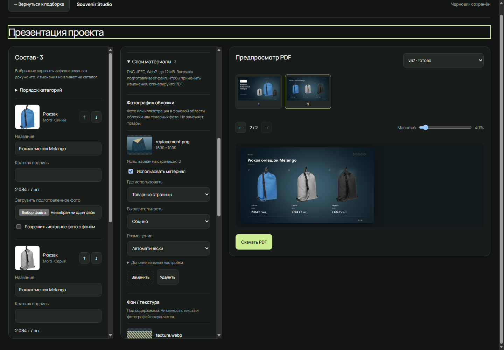
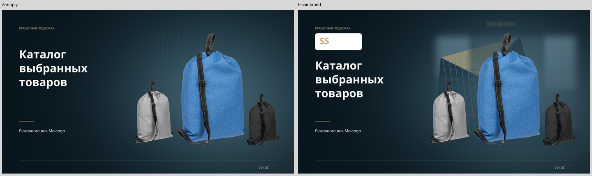
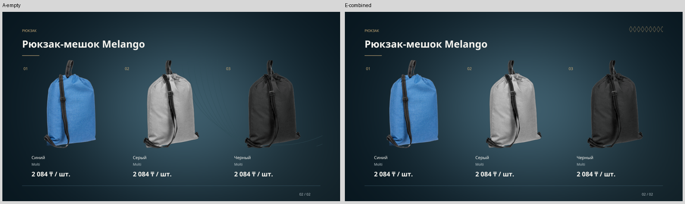

# Свои материалы — Premium Dark 3

30 октября 2026. Реализовано в существующем редакторе, API, очереди подготовки
и общем PDF renderer. Проверено на заполненной PostgreSQL, через основной HTTP
API и установленный Microsoft Edge. Новых зависимостей и миграций нет.

[Контрольный PDF](../apps/api/tests/fixtures/presentations/custom-materials/premium-dark-custom.pdf)
· [Обложка](../apps/api/tests/fixtures/presentations/custom-materials/cover.png)
· [Товарная страница](../apps/api/tests/fixtures/presentations/custom-materials/variants.png)
· [Manifest](../apps/api/tests/fixtures/presentations/custom-materials/manifest.json)
· [Все 30 просмотренных страниц](../apps/api/tests/fixtures/presentations/custom-materials/pages/)

## Редактор

В «Оформлении» Premium Dark добавлена раскрываемая секция «Свои материалы»:

| Зона | Роль | Поведение |
|---|---|---|
| Фотография обложки | COVER_PHOTO | Фото/иллюстрация под товарами в безопасной области; исходно только обложка |
| Фон / текстура | BACKGROUND | Под содержимым, с локальным сохранением читаемости |
| Декоративные элементы | DECORATION | Несколько файлов, свободные поля без пересечения с товарными блоками |

Логотип остаётся отдельным существующим элементом. Поле названия презентации
не возвращалось. Названия товаров редактируются как прежде. Материалы не меняют
подборку, каталог, фотографии вариантов и коммерческие значения snapshot.

Для файла доступны включение, замена, удаление, область COVER / PRODUCTS /
DOCUMENT, выразительность и предпочтение размещения. В дополнительных настройках —
разрешение обрезки фото/фона, точка внимания, интенсивность, согласование декора
с палитрой, обязательность и краткое описание. DOCUMENT разрешает использование,
но не требует повторения на каждом листе. Фото с областью PRODUCTS использует
безопасное фоновое поле товарных фотографий; оно не становится изображением товара.

Загрузка только подготавливает файл. Изменения сохраняются, PDF создаётся явной
кнопкой. Пока готовится новая версия, старый preview остаётся виден с пояснением.
Скачивание прежней версии явно обозначено как прежнее. F5 и повторное открытие
восстанавливают файлы и настройки. Статус применения относится к выбранной ревизии,
а не к одному факту успешной загрузки.

[Mobile](../apps/api/tests/fixtures/presentations/custom-materials/editor-mobile.png)
· [Декор на mobile](../apps/api/tests/fixtures/presentations/custom-materials/editor-mobile-decoration.png)

## Размещение

Путь сохранён: collection → snapshot → DesignPlan → ReportLab → PDFium.
Перед размещением общий painter измеряет фактические перенесённые заголовки,
подписи, цены, фотографии, логотип и footer. Учитывается итоговая геометрия,
включая длинные строки. Затем размещаются дополнительные слои.

Фото использует выделенное поле с сохранением пропорций и мягким краем;
обрезка возможна только по настройке пользователя и с его точкой внимания.
Фон получает локальное ослабление под текстом/логотипом и фотографиями.
Контрастная текстура дополнительно приглушается, оставаясь видимой.
Декор размещается в свободных коридорах; масштаб и пропорции ограничены.
При реальном использовании материала встроенные дуги на этой странице отключаются.
Белые овалы за товарами не возвращены. Логотип не обрезается и не перекрашивается.

Невозможное размещение пропускается с объяснением. Обязательный неприменённый
материал переводит результат в NEEDS_REVIEW; API блокирует скачивание и approval,
редактор показывает причину. В контроле требование LEFT для орнамента не
совместилось со свободными зонами — пересечение с товарами не допущено.

[Контролируемый отказ в редакторе](../apps/api/tests/fixtures/presentations/custom-materials/required-review.png).

## Подготовка и безопасность

Общая подготовка ролей использует существующую очередь PresentationRevision
с внутренним kind=PREPARE_MATERIAL; служебные задания не выдаются как PDF-версии.
Общий лимит очереди 12, на пользователя — 2 активных задания. CPU-декодирование
выполняется вне API event loop и БД-транзакции. Отмена и исчерпанный retry не
оставляют вечный статус подготовки.

Принимаются PNG, JPEG, WebP по содержимому. EXIF применяется, ICC преобразуется
в sRGB; прозрачность сохраняется. Автоматического удаления фона нет. SVG, архивы,
шрифты и исполняемые форматы не поддерживаются. Ошибка файла видна в карточке;
неудачная замена сохраняет прежний материал. Успешная замена наследует настройки
и получает новый ID/оригинал/hash. Исходное имя не используется для пути.

| Настройка | Значение по умолчанию |
|---|---:|
| PRESENTATION_MATERIAL_MAX_BYTES | 12 MiB |
| PRESENTATION_MATERIAL_MAX_PIXELS | 16 000 000 |
| PRESENTATION_MATERIAL_MAX_TOTAL_BYTES | 64 MiB на документ с сохранёнными версиями |
| PRESENTATION_MATERIAL_MAX_FILES | 12 записей текущего черновика |
| PRESENTATION_MATERIAL_MAX_DECORATIONS | 6 |
| PRESENTATION_MATERIAL_TIMEOUT_SECONDS | 20 s |

Оригиналы неизменяемы и принадлежат документу; нормализованные копии и миниатюры
кэшируются по полному hash и версии подготовки. В тестах обнаружен Windows
MAX_PATH для вложенного пути с длинным hash: подготовленный кэш размещён в
коротком пространстве assets/custom, доступ остаётся авторизованным.
Фото требует не менее 640 по большей и 160 по меньшей стороне; фон — 128 по меньшей.

Input ревизии хранит точные настройки и версии файлов; result — фактические
страницы, области, hash и причины пропуска. Удаление из черновика не удаляет файл,
нужный старой ревизии. Чтение оригинала/thumbnail/preview/PDF проверяет владельца;
чужие ссылки возвращают 404. Сохранение настроек использует прежний version/CAS.

Маршруты: POST `/api/presentations/{id}/materials?role=...&version=...&replace=...`
с bytes и необязательным X-Filename; GET
`/api/presentations/{id}/materials/{asset_id}?thumbnail=true`.
Приватные storage keys из клиентского ввода не принимаются.

## План и совместимость

Premium Dark сохраняет style_version=3. Независимый material_schema_version=1
расширяет закрытый DesignPlan. Без материалов и при их выключении не добавляются
операторы рисования: A и F побайтово совпали с прежним V3, SHA-256
`5f0517fd5f5fd0ae952792b854414625f82a147a62e528c50f23744bb957d92d`.
Все три V2-эталона воспроизведены на тех же вариантах: PDF hashes и пиксели всех
шести страниц совпали. Editorial и Modern Graphic не получают новых материалов;
редактор объясняет необходимость Premium Dark. Старые input/plan/PDF сохраняются.

Прежняя локальная Qwen получает роль, размеры, прозрачность и описание, без
изображений, client identity, цен и приватных путей. Decoding schema разрешает
только enabled IDs этого документа; scope проверяется повторно. Описание — данные.
Неизвестный ID, выключенный материал, нарушение scope и timeout проверены
регрессиями; детерминированный fallback сохранён. Live-приёмка выполнена с AI off:
успешная работа Qwen именно с этими материалами **NOT TESTED**.

## Фактическая приёмка

Документы созданы через основной HTTP API в изолированных проектах. Контроль —
реальные vto:1823109 / 1823108 / 1823107: синий, серый и чёрный Melango, Molti,
по 2084 ₸/шт. на момент snapshot. Фото соответствуют вариантам. G-six добавляет
реальные ручки и бутылку из существующего индекса.

Здание — собственная программная иллюстрация, не фотография реального объекта.
Орнамент, насыщенная текстура и нейтральный SS-логотип также созданы для теста.
Исходники и hashes — sources/provenance.json. Корпоративные материалы не публиковались.

| Случай | Результат | Статус |
|---|---|---|
| A: без материалов | 2 страницы, точный прежний V3 hash | PASS |
| B: только фото | Фото на обложке; товарная страница сохранена | PASS |
| C: прозрачный PNG | Свободные зоны, без пересечения с ценами/товарами | PASS |
| D: насыщенная текстура | Читаемость сохранена, встроенных дуг нет | PASS |
| E: логотип + фото + орнамент | 3 исходных товара, согласованная композиция | PASS |
| F: выключение | Точный hash A; прежние ревизии доступны | PASS |
| G: длинные строки, 1/3/6 товаров | 2/2/4 страницы, измеренные безопасные области | PASS |
| H: низкое разрешение / повреждение / oversize | Ошибки файла и HTTP 413, прежний материал сохранён | PASS |
| I: невозможное обязательное размещение | NEEDS_REVIEW, причина, download/approve заблокированы | PASS |
| J: чужой пользователь | Thumbnail, preview и PDF — 404 | PASS |
| K: scope PRODUCTS для фото | Только страница 2, текст не перекрыт | PASS |
| L: замена JPEG → PNG | Новый ID/hash, настройки и исторические bytes сохранены | PASS |
| Edge desktop/mobile | Upload, autosave/F5, generate/download, delete, back/reopen | PASS |

Просмотрены **30 финальных PDFium-страниц**. Первые B/D/E выявили жёсткий край фото
и слишком активную текстуру; после исправления шесть страниц перерендерены и
просмотрены заново. Manifest содержит финальные результаты. Успешные PDF скачаны
с ownership-проверкой и сверены по SHA-256 с ревизией/preview; I намеренно не
объявлен готовым PDF.

В Edge проверены 1440×1000 и 390×844 без горизонтального overflow: загрузка декора
не запускает PDF, миниатюры готовы асинхронно, параметры восстанавливаются после
F5, прежний preview виден при новой генерации. Удалённый декор отсутствует в
черновике, но доступен старой ревизии. Back и повторное открытие через список
документов сохраняют три товара и настройки.

## Измерения и проверки

Подготовка: JPEG .117 s, прозрачный PNG .017 s, WebP .103 s.
Последующие настройки берут копии из кэша; интенсивность/область декора не
вызывают повторный matting товарных фото.

| Документ | Страниц | Assets, s | PDF, s | Preview, s | Всего, s |
|---|---:|---:|---:|---:|---:|
| A без материалов | 2 | .734 | 1.066 | .172 | 2.167 |
| B фото | 2 | .031 | 2.338 | .184 | 2.727 |
| C декор | 2 | .029 | 2.245 | .195 | 2.646 |
| D текстура | 2 | .028 | 2.308 | .392 | 2.894 |
| E вместе | 2 | .030 | 2.399 | .378 | 2.969 |
| F выключено | 2 | .029 | 1.043 | .169 | 1.416 |
| G шесть товаров | 4 | 5.040 | 2.777 | .479 | 8.458 |
| K фото в PRODUCTS | 2 | .044 | 2.408 | .301 | 2.967 |
| L замена | 2 | .028 | 2.580 | .262 | 3.039 |

RSS worker-дерева около 92–107 MiB для кэшированных запусков; G-six достиг
**749 MiB** при подготовке дополнительных товарных фото. Это существующий matting,
не подготовка фона. SIMPLE smoke: HTTP 202 за .528 s, 85 карточек, подборка
сохранена. Десять health-запросов .0034–.1044 s. Это smoke-измерения, **не p95**
и не доказательство широкой concurrency.

| Проверка | Результат |
|---|---|
| Полный backend pytest | PASS: 427 passed, 1 opt-in deselected; 248.26 s |
| Новые material regressions | PASS: 14, subprocess/API, scope, ownership, cancellation, replacement, ICC/EXIF, quota, AI fallback |
| Frontend component/state tests | PASS: 18 |
| Ruff / ESLint / TypeScript / production build | PASS |
| Skill validation / git diff --check | PASS |
| HTTP, PostgreSQL, Edge DOM, 30 PDF-страниц | PASS |
| Live Qwen с custom materials, длительный load, другие браузеры | NOT TESTED |

Постоянный `scripts/check_custom_materials.py`: prepare → run → осмотр страниц →
refresh-visuals при изменении renderer → approve --reviewed → prime-ui → Edge →
scope-products → replace-valid → осмотр → approve --reviewed → verify → cleanup.
Ledger с cookies хранится только в .local, не коммитится. Правила добавлены в
[существующий presentation skill](../.agents/skills/souvenir-presentation/SKILL.md).

## Сохранность и границы

До/после: **4371 offer**, тот же offer/observation fingerprint
`b64e9d7dfb7cc8b653d9389f8cd6e4dc`. База, коллекции, реальные документы,
логотипы и товарный кэш не сбрасывались; VTO jobs/checkpoints не изменялись
кодом задачи. Существующие дефекты масок стекла/ремней остаются отдельной задачей;
декор не исправляет их. SVG и явное удаление фона декора в этой версии не
предлагаются. Произвольного перетаскивания и координатного редактора нет.

Очистка по точным ID выполнена: удалены 2 тестовых аккаунта, 4 проекта и
4 документа с их задачами/файлами. SQL подтвердил 0 оставшихся тестовых
аккаунтов, документов и ревизий; 4 остальных документа сохранены, fingerprint
их черновиков до/после очистки одинаковый. Ledger/cookies, временные страницы,
probes и логи остановленных процессов удалены. Shared custom cache удалялся
только для созданных тестом ключей без ссылок из других документов/ревизий;
товарные фотографии и действующие service logs сохранены.

**Cleanup PARTIAL:** автоматическая проверка разрешений отклонила рекурсивное
удаление `.local/custom-materials-edge-profile`. Папка оставлена. Edge штатно
закрыт, listener 9224 отсутствует; тестовые аккаунты и их сессии удалены.
Других временных acceptance-ресурсов этого запуска не осталось.

После очистки основной API, frontend и его health proxy вернули HTTP 200.
PostgreSQL, Ollama, API и frontend оставлены работающими.
