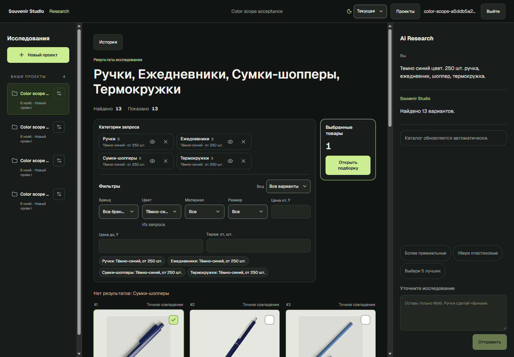

# Общий цвет, составные оттенки и HUD

Проверено 6 ноября 2026 года на основной PostgreSQL, HTTP API и в установленном
Microsoft Edge. Контрольный запрос теперь создаёт четыре ветки с **DARK_BLUE,
quantity >=250, без модели и бренда**. HUD получает действующее состояние от
сервера. На измеренном VTO-индексе получено **13 вариантов: 5 ручек, 5 ежедневников,
0 шопперов, 3 термокружки**. Отсутствие подходящих шопперов не ослабляет фильтры
и не скрывает товары остальных категорий.



## Подтверждённые причины

Фактический путь: HTTP `/projects/{id}/requests` → ProjectQueryService/router →
`grid_plan` → catalog identity → typed attributes → product branches/source
regions → `grid_conditions` → scalar SQL → purpose/model verification →
persisted ResearchRecord → `grid_response` → ResearchFilterPanel/ResearchConditions.

1. **Ложная модель.** `resolve_identity` использовал остаток
   `parse_constraints`, затем исключал цветовые слова по одному токену.
   Полная фраза «Темно синий» распознавалась как DARK_BLUE при извлечении атрибутов,
   но не потреблялась из остаточного текста. «синий» отбрасывался, «Темно» оставалось
   моделью первой товарной группы. До исправления SQL пропускал 9 ручек, проверка
   назначения — 5, а ложная модель отсекала все 5.
2. **Неверный scope.** `source_segments` разделял списки по запятым/союзам,
   но не отделял самостоятельные предложения. Первая товарная область включала
   весь префикс `Темно синий цвет. 250 шт. ручка`. При выделении общего остатка
   эта область удалялась; прежний дополнительный проход восстанавливал только
   предложения после точки. Поэтому `250 шт.` становилось общим ограничением,
   а самое первое предложение с цветом оставалось у ручек.
3. **HUD.** Dropdown читал `view.filters.colors`, игнорируя ограничения исходных
   веток. Пустой дополнительный фильтр показывался как «Все». Плашки также
   использовали отдельный frontend category lookup без shopperbag, откуда «Мерч»
   вместо серверного имени «Сумки-шопперы».

При браузерной проверке обнаружен ещё один конкретный дефект History:
`workspaceApi.activate` отправлял POST с `Content-Type: application/json`
и пустым body. Проверка запроса возвращала **400 INVALID_JSON**. Тот же вызов
с JSON-объектом возвращает **200**. Исправлен только этот вызов: body=`{}`;
авторизация, middleware и общий API-клиент не менялись.
[Доказательство HTTP-контракта](screenshots/color-scope/history-contract.json).

## Исправление

`query_constraints.color_spans` использует существующие ColorNormalizer patterns
в порядке от конкретного оттенка к общему. Типизированный ColorSpan сохраняет
текст, границы и роль COLOR; целиком потреблённая фраза больше не становится
остаточной моделью. Нормализуются регистр, ё/е, повторные/неразрывные пробелы
и распространённые дефисы. Исходный запрос остаётся в `raw_query/original_query`,
результат сопоставления — в `query_understanding.color_spans`.

Существующие **DARK_BLUE, NAVY, BLUE, LIGHT_BLUE** не объединялись. Условия SQL
используют точный DARK_BLUE. Товарная таблица оттенков и нормализация импортера
не менялись. Fixture с NAVY, обычным синим и голубым исключает их из строгого
тёмно-синего запроса, даже при достаточном количестве.

Границы предложений теперь отделяют вводные/заключительные атрибуты от
товарных областей. Атрибутный остаток задаёт общие условия; локальный участок
переопределяет их только для своей ветки. Конструкция «но ручки красные»
обрабатывается как явное локальное переопределение, а не как пятая позиция
или RED AND DARK_BLUE. `branch.origins.colors` сохраняет global/local/override
и исходный фрагмент. Явные взаимоисключающие требования с «одновременно» или
«только … и только …» требуют уточнения; обычные альтернативы остаются возможны.

Подтверждённые brand/model spans остаются защищёнными. Постоянные проверки
`бренд Blue Lake`, `ручки модель Blue`, Tippo, Melango и SKU прошли. Никаких
`if query == …` или списка исключений для слова «Темно» не добавлено.
Очевидный запрос выполняется детерминированно; live `llm_used=false`.

`grid_response.color_state` — вычисляемая серверная проекция исходных веток
и дополнительных фильтров: none/uniform/mixed/conflict, source values,
additional values и конфликтующие branch IDs. Она не записывает цвет во второй
фильтр. Dropdown показывает исходный оттенок с отметкой «Из запроса», сохраняет
его со счётчиком 0 при пустых facets, а разные условия — как
«Разные по категориям». Дополнительное сужение сохраняет прежнюю семантику;
при конфликте есть объяснение и команды замены/снятия исходного условия.

Сброс дополнительных фильтров оставляет исходный цвет. «теперь красные» заменяет
веточные цвета и глобальное поле intent согласованно, очищая конфликтующий
дополнительный цвет; «цвет не важен» снимает требование через ревизию. Исходное
сообщение в истории не переписывается. Плашки получают имя по тому же branch ID,
что и QueryCategories; для shopperbag добавлено корректное fallback-имя.

Кэш интерпретированных intent здесь не используется. Существующий vocabulary
cache не хранит эти scope-решения; очищать каталог или пользовательскую историю
не потребовалось. `color_scope_version=color-scope-v1` отмечает новый разбор.
Старые сохранённые intent не перепарсиваются задним числом: повторный
самостоятельный запрос создаёт новую поисковую запись.

## До / после

Точный запрос выполнен до исправления в новом проекте и после красных бутылок.
Оба раза router выбрал NEW_SEARCH и получилась одинаковая ошибочная структура.

| Поле | До | После |
|---|---|---|
| Общий цвет | отсутствует | DARK_BLUE |
| Общий минимум | 250 | 250 |
| Ручки | DARK_BLUE, 250, модель «Темно» | DARK_BLUE, 250, без модели |
| Ежедневники | без цвета, 250 | DARK_BLUE, 250 |
| Шопперы | без цвета, 250 | DARK_BLUE, 250 |
| Термокружки | без цвета, 250 | DARK_BLUE, 250 |
| Brand constraints | отсутствуют | отсутствуют |
| Дополнительный цвет | [] | [] |
| Dropdown | «Все» по прежней логике компонента | «Тёмно-синий» из серверного состояния |
| Полный matching pool | 118 | 13 |

Сырые HTTP-ответы, persisted intent, веточные origins, исходные сообщения,
router actions и revisions сохранены в [before.json](screenshots/color-scope/before.json)
и [after.json](screenshots/color-scope/after.json). Старый baseline содержит
полные pool IDs, включая товары за первой страницей.

Во время работы штатный уже запущенный VTO worker продолжил импорт:
число offers изменилось **5907 → 6634**. Поэтому 118→13 не выдаётся за сравнение
на неизменной базе. Во время финальной HTTP-проверки A/B каталог был стабилен:
6634 offers, fingerprint `f49f58947522179478dc4e7ed04dfa92` в начале и конце.
Дополнительно оба плана исполнены в одной READ ONLY / REPEATABLE READ транзакции.

## Реальный candidate funnel

Числа SQL относятся к одному итоговому snapshot. Последняя колонка учитывает
также существующую проверку основного назначения товара; она не подменяется
лексическим совпадением. Цвет и stock проверяются через один SupplierOffer ID
и его ProductObservation, до пагинации, без суммирования соседних вариантов.

| Ветка | SQL до цвета | После DARK_BLUE | После stock >=250 | После purpose/model |
|---|---:|---:|---:|---:|
| Ручки | 306 | 14 | 9 | **5** |
| Ежедневники | 134 | 13 | 6 | **5** |
| Сумки-шопперы | 4 | 0 | 0 | **0** |
| Термокружки | 96 | 13 | 3 | **3** |

Для шопперов зафиксирован `COLOR_NO_MATCH`, а не недостаток тиража или ошибка
категории. Неизвестные цвет/количество не используются как подходящие.
Параметризованные SQL statements, параметры и полные candidate IDs каждого
этапа находятся в `after.json → sql`; финальные ID — в `cases.A_fresh.offer_ids`.

Итоговые предложения:

```text
Ручки: vto:1861634, vto:1904946, vto:1944515, vto:1955686, vto:1955696
Ежедневники: vto:1944316, vto:1944325, vto:1957387, vto:1958015, vto:1961442
Шопперы: нет
Термокружки: vto:1949338, vto:1954159, vto:1954174
```

Сравнение A (общий цвет) / B (повторённый локальный цвет) — **PASS**:
совпали все 13 конечных SupplierOffer IDs, а также полные SQL candidate sets
на одном repeatable-read snapshot. Сравнивались эффективные ограничения,
а не случайные branch UUID или JSON побайтно. Тестовая выдача на 118 подходящих
offers дополнительно проверяет все страницы, а не только первые 100.

Live HTTP время: A в новом проекте **1.8935 s**, B **2.1148 s**, A после предыдущего
контекста **2.2975 s**. Это отдельные smoke-измерения, не нагрузочные p50/p95.
Лимиты, пул, параллелизм и число API workers не увеличивались.

## Проверки

| Проверка | Статус / фактический результат |
|---|---|
| Профильные backend regressions | PASS: 101 tests, включая новые scope/variant случаи |
| Первый полный backend suite | FAIL: 548 passed, 1 failed, 1 deselected |
| Повтор упавшего теста отдельно | PASS: 1 test, 1.17 s |
| Повторный полный backend suite | PASS: **549 passed, 1 deselected**, 225.63 s |
| Финальные frontend component/state tests | PASS: **52 tests** |
| Основной HTTP API / PostgreSQL / persisted revisions | PASS: **32 checks** |
| Edge с реальным frontend/API | PASS: **19 checks**, 13 точных offer IDs в DOM |
| Ruff / ESLint / TypeScript / production build / diff check | PASS |
| Файлы PDF pipeline/assets/dependencies | PASS: **131 SHA-256**, 0 изменений |
| Отдельный opt-in PostgreSQL test | NOT TESTED: исключён штатным pytest addopts |
| Другие браузеры/ОС, mobile и длительная нагрузка | NOT TESTED в этой итерации |

Этот завершённый index-search не открывает SSE-подписку. Отдельная инъекция
устаревшего SSE-события в этой приёмке — NOT TESTED; существующие проверки
отбрасывания поздних ответов/ошибок прежнего workspace прошли frontend suite.

Первый полный прогон один раз упал в
`test_title_variation.py::test_duplicate_key_new_generation_and_failed_retry_reuse_frozen_input`:
из двух параллельных PDF generate-запросов один вернул 422 для материала
`251.png`. Изолированный повтор и весь следующий прогон прошли. Причина
интермиттирующего отказа не установлена; его исправление не заявляется.
PDF-код и исходный материал не менялись. Этот первый FAIL не скрыт итоговым PASS.

Новые fixtures имеют независимые ожидаемые IDs: в каждой из четырёх категорий
есть DARK_BLUE при 250/251/249, BLUE, NAVY, LIGHT_BLUE, RED, неизвестный цвет
и неизвестный stock. Проверены перестановки общего условия, ё/е/пробелы/дефисы,
локальные цвета и override, противоречия, source/extra reset, ноль, paging,
hide/remove/restore/Undo, новый запрос после контекста и сохранность коллекции.
Существующие проверки брендов, моделей, отрицаний, revisions, request safety
и конкурентных операций входят в полный suite.

В Edge выполнены реальные действия: источник цвета, все четыре плашки,
точные data-offer-id, dropdown, смена Current/Pulse, hide/show, F5,
нулевая выдача и нулевой facet, reset, «теперь красные», смешанные цвета,
выбор нужной записи History, «цвет не важен» и повтор исходного запроса.
До F5 проверяется завершение сохранения, а не только optimistic скрытие.
Успешный 202 сам по себе не использовался как PASS.

Финальные скриншоты просмотрены:
[Current](screenshots/color-scope/hud-current.png),
[Pulse](screenshots/color-scope/hud-pulse.png),
[dropdown](screenshots/color-scope/color-dropdown.png),
[нулевые facets](screenshots/color-scope/zero-results.png),
[замена на красный](screenshots/color-scope/red-refinement.png),
[разные цвета](screenshots/color-scope/mixed-colors.png).
[Browser receipt](screenshots/color-scope/browser.json).

## Изменённые компоненты и сохранность

Изменены `domain/query_constraints.py`, `domain/catalog_identity.py`,
`domain/query_branches.py`, `application/product_grid.py`,
`application/project_queries.py`; frontend `research-filters.tsx`,
`lib/research.ts`, `lib/format.ts`, `lib/project-queries.ts`.
Добавлены постоянный `test_global_color_scope.py`, component regressions и
`scripts/check_color_scope.py` / `check_color_scope_browser.py`.

Миграций, SQL-обновлений товарных цветов, сбросов каталога, изменений importer,
stock policy, PDF, авторизации, themes или Geist нет. Предыдущие незакоммиченные
изменения шрифта сохранены. Нормальная фоновая синхронизация не приостанавливалась
и не выдавалась за recovery этой задачи.

Тестовые users/projects создавались изолированно. Cleanup удалил ровно один
записанный task-owned аккаунт и четыре записанных проекта; чужие ID и данные
не удалялись. Browser profile/processes, ledger/cookies и промежуточный failure
capture убраны. Постоянные проверки и evidence сохранены.
[Cleanup receipt](screenshots/color-scope/cleanup.json).
SQL подтвердил отсутствие всех удалённых test IDs; итоговые health checks и
контрольные хэши — в [verification.json](screenshots/color-scope/verification.json).
PostgreSQL, Ollama, основной API и frontend оставлены работающими.

Повторение: `scripts/check_color_scope.py prepare`, затем `run`,
`scripts/check_color_scope_browser.py`, затем `check_color_scope.py cleanup`
через `.venv\Scripts\python.exe` из корня. Нужны работающие основные сервисы
и установленный Edge; Chromium runtime не устанавливается.
