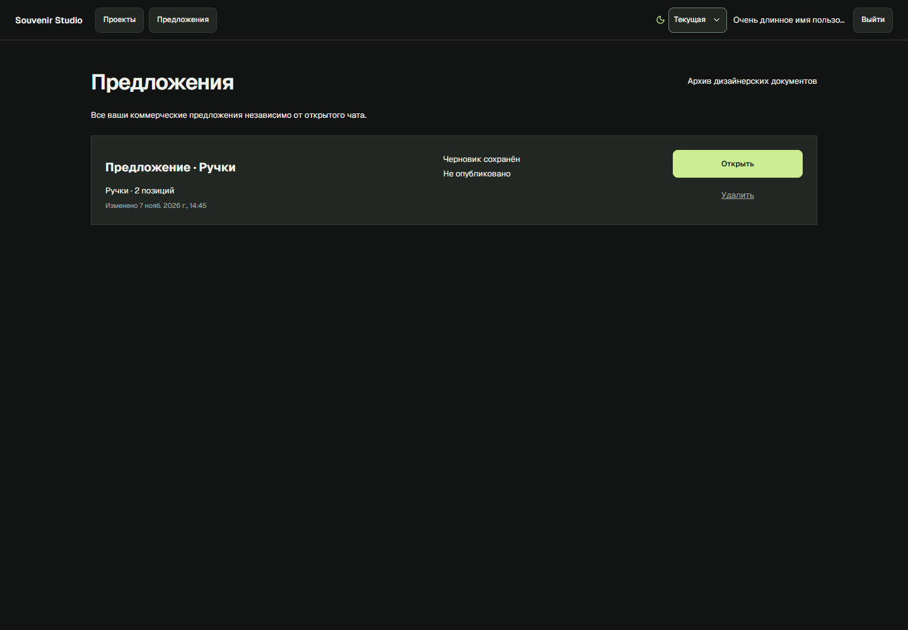
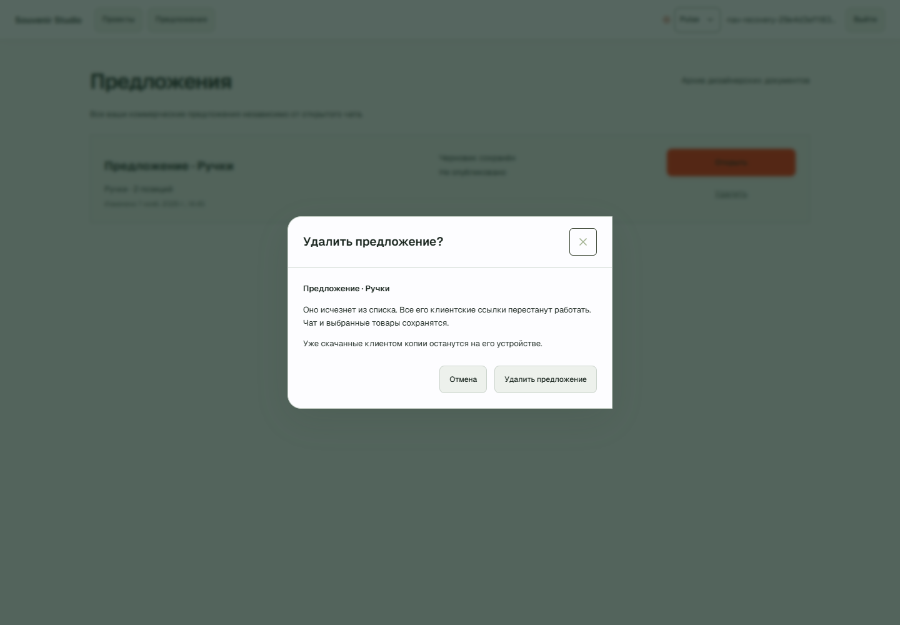
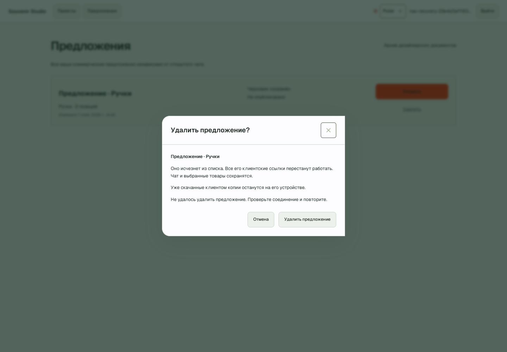

# Navbar, удаление предложений и восстановление импорта VTO

7 ноября 2026. **Navbar: PASS. Удаление: PASS. Политика восстановления:
PASS в контролируемых проверках; реальная скорость наполнения: PARTIAL.**
VTO продолжает отвечать 502 на проверенных listing-ресурсах. Новые товары за
наблюдаемое окно не появились; ускорение загрузки каталога не заявляется.

## Navbar

Причина измерена в установленном Edge до изменения: чат имел высоту шапки
64 px, список предложений — 45 px. Кнопки 44 px в предложениях начинались
на y=0, без верхнего/нижнего пространства. Страница вне workspace не наследовала
его строку 64 px, а собственный flex override задавал другую геометрию.
Compact theme selector дополнительно переопределял min-height на 38 px.
[DOM до изменения](screenshots/nav-delete-recovery/navbar-before.json).

Один `AppNavbar` используется в чатах/проектах и списке/архиве предложений:
бренд → навигация → контекст чата → тема, имя, выход. Минимальная высота задаётся
общим token; строка workspace теперь auto, без обрезания растущего содержимого.
Desktop: **64 px**, все controls **40 px**, вертикальные отступы около 11–12 px.
Mobile: **111 px**, две строки, основные действия доступны. Длинное имя ограничено
ellipsis с полным tooltip. Отрицательных отступов и абсолютного navbar нет.
Geist, dropdown, focus styles и независимые области прокрутки сохранены.
Клиентская шапка опубликованного предложения не менялась.

В Edge проверены Current/Pulse, чат/предложения, 1440×1000, mobile 390×844,
эффективные viewport/DPR для 125% и 150%. Это реальные DOM и screenshots;
увеличение через нативное меню браузера отдельно **NOT TESTED**. Длинное имя —
явная UI-only fixture, профиль настоящего пользователя не переименовывался.

## Ручное удаление

Добавлена совместимая миграция **0027_offer_deletion**: nullable deleted_at
документа и offer_generation проекта. Прежние документы не помечались удалёнными.

`DELETE /api/offers/{id}` принимает confirmed=true и version. Сервер проверяет
владельца и commercial kind. Короткая транзакция блокирует проект, документ и
share, выставляет tombstone, увеличивает version/epoch, выключает ссылку, снимает
pending publication и отменяет активные адресные revisions/claims.
Архив дизайнера этой операцией не удаляется. Предыдущий коммерческий документ
можно удалить без изменения основного и без автоматического продвижения старых копий.

Удалённый документ исключён из обычных/project lists и primary lookup. Owner GET,
draft/revision images, PDF/XLSX, preview, legacy compatibility routes и public
token checks проверяют tombstone. Удалённый expired key даёт недоступность, не
продлевается. Повтор удаления идемпотентен и не затрагивает новый документ.
Worker final publish, asset freeze, material completion и CAS-save также
проверяют состояние. Worker целиком не завершается ради одного документа.
Claim выбирает только живые документы и блокирует revision, сохраняя порядок
блокировок относительно удаления/публикации.

`GET /api/projects/{id}/offer-state` возвращает offer и generation без создания.
После удаления основного generation увеличивается. Старый POST get-or-create
с прежней generation получает 409, даже если затем создан новый основной документ.
Новое предложение создаётся отдельным действием с актуальной generation и новым ID.
Открытие прежнего редактора показывает недоступность и ссылки возврата.

В списке вторичное «Удалить» открывает подтверждение с названием и последствиями.
Cancel ничего не меняет; submit блокируется, успех показывается только после ответа.
При сетевом отказе строка остаётся, ошибка и повтор доступны внутри диалога.
Чат, Message, ProjectCollection и каталог удалением предложения не затрагиваются.
Файлы tombstone остаются в storage; новая массовая физическая очистка не добавлена.
Скачанные клиентом копии удалённо не стираются.

Проверено фактическое старое поведение TTL: **14 дней закрывают публичную ссылку,
не удаляют документ/экспорты владельца**. Управляемые часы проверяют границу,
owner list и download после истечения, затем отдельное ручное удаление.
Системные часы и сроки настоящих документов не менялись. Даты интерфейса используют
Asia/Almaty; подпись «Екатеринбург» удалена, UTC вручную не сдвигается.

## Причина ожидания VTO

Перед правками SQL зафиксировал **9820 offer, 3110 семейств с предложениями**;
checkpoint — 3139 обработанных родителей, следующая страница 40, 9 failed cards.
Источник последней ошибки: **502**, Store API, listing page=40, per_page=100,
orderby=date/order=desc. Сохранённый retry_after_seconds=0. Достоверной отдельной
HTTP-header записи старый код не сохранял: отсутствие старого короткого заголовка
не выдаётся за доказательство. Старая реализация сохраняла Retry-After >60 s отдельно.

Первую длинную паузу назначил `IndexRepository.finish`: base=15 минут,
failures=2 → **30 минут**. retry_after=09:17:12 UTC / 14:17:12 в приложении.
В тот момент активного worker не было; старый circuit_open_until уже истёк.
Это не ожидание завтрашнего refresh. Provider до этого делал до трёх HTTP attempts
с короткими sleeps. Повторный scheduler enqueue приближал job.available_at,
но supplier.retry_after продолжал запрещать claim, поэтому сроки выглядели разными.

В новом live-окне выявлено и конкурирующее ожидание: lease забирал refresh остатков,
пока полный импорт был overdue. Scheduler coalescing мог также стирать локальный
job-level wait. Обе причины исправлены отдельно от сетевого backoff.

## Новая политика и checkpoint

- Один HTTP attempt в адаптере; повторы принадлежат durable queue. Нет произведения
  HTTP retries × job retries. Первые временные отказы без supplier deadline:
  **60–90 s**, затем **90–120 s**, с jitter. Продолжающиеся 5xx увеличивают паузу
  с circuit, ограниченным прежним безопасным максимумом.
- 429/Retry-After seconds/date сохраняют абсолютный нижний срок. Следующее время —
  максимум ограничений, без сложения. 403/access/CAPTCHA имеют отдельную причину
  и защитную паузу; CAPTCHA сохраняет минимум час. Локальная DB/contract ошибка
  и ошибка карточки не превращаются в transport outage.
- DB connection/lease/worker slot не удерживаются во время ожидания. Claim проверяет
  shared retry и circuit; перезапуск не обнуляет срок и attempts. Scheduler enqueue
  сохраняет retry_decision.next_attempt_at. Полноценная здоровая TIME_BUDGET порция
  продолжается примерно через секунду, без ежедневного расписания.
- Overdue initial import получает возможность claim перед очередным фоновым refresh.
  Права пользовательских поисков и индексный путь не менялись.
- Повторно неудачная listing-страница сохраняется в failed_listing_pages, а здоровые
  страницы можно обходить дальше. Пропуск обязателен к повторной проверке; после
  исчерпания бюджета это PARTIAL/FAILED, а не coverage_complete. Во время массовых
  5xx перенос страницы не сокращает общий transport backoff.
- После повторных listing 5xx разрешена **одна** проба меньшего ответа на следующем
  законном lease. Только валидный ответ позволяет преобразовать offset, page size и
  диапазоны failed pages. ID, pending cards, order и stock не переписываются.
  Неуспешная проба не повторяется циклически и не меняет курсор/размер страницы.

Совместимая автоматическая коррекция старого ожидания ограничена доказанными
старыми 502/503/504, failures 1–2, истёкшей lease и отсутствием сохранённого
supplier deadline. Она привязана к старому моменту ошибки, а не к now+новый срок.
Активные lease, circuit, чужие jobs и неопределённые ограничения не обнуляются.

Технический `/api/dev/index` получает execution state/reason/assigned_by,
next_attempt_at, source stage/status/resource/latency/Retry-After, lease/circuit,
last successful record, work/wait time, lag запуска и ограниченную серию progress samples.
Прогресс родителей, variants и страниц разделён. Блок статуса в чат не возвращён.
Параллелизм, RPS, request timeout, order, цены, SKU и LAST_KNOWN_STOCK_ALLOWED не повышались/не менялись.

## Реальные измерения — PARTIAL

[Исходный SQL snapshot](screenshots/nav-delete-recovery/before-import.json) ·
[Серия снимков](screenshots/nav-delete-recovery/import-samples.json).

В live действительно назначен первый короткий retry: 09:24:22.710336 UTC →
09:25:32.434510 UTC, **69.724 s**. Для одного позднего разрешённого запуска
зафиксирован lag **89.96 ms**. Это не утверждение, что все попытки стартовали
за 90 ms: в предыдущих попытках присутствовало ожидание другого supplier lease.

VTO вернул 502 для page=40/100 и page=41/100. В рамках единственного штатного
импортера разрешённая проба page=81/50 того же offset также вернула **502 за
12.688 s**, без Retry-After. Поэтому page size остался **100**, checkpoint не
выдаётся за успешную проверку. После пятого последовательного source failure
защитная попытка назначена на **14:54:47 UTC+5**. Эта длительная пауза относится
к продолжающимся подтверждённым 5xx, не к одиночному первому отказу.

На интервале **09:13:38–09:49:27 UTC**:

| Метрика | Фактический результат |
|---|---:|
| Уникальные offers | 9820 → 9820, новых 0 |
| Семейства с предложениями | 3110 → 3110, новых 0 |
| Реальные вариационные offers в последнем снимке | 9193 |
| Дополнительные HTTP calls / HTTP errors полного импортера | 7 / 7 |
| Дополнительное время slices | 103.329 s |
| Измеренная work-host метрика ожидания с начала новой записи | 992.963 s |
| HTTP calls на новый вариант | NOT MEASURABLE: знаменатель 0 |
| Скорость новых данных за это окно | 0; ускорение не подтверждено |

Историческое ожидание до появления метрики waiting_seconds не реконструируется.
Первичный импорт всё ещё неполон. Уменьшение таймера не называется ускорением
каталога. Поиск через основной API дал **1.276 / 1.950 s** при включённом sync;
это smoke во время цикла ожиданий/ошибок, не p95 и не тест длительного здорового
ввода. ETA окончания не рассчитывается.

## Проверки и сохранность

| Проверка | Результат |
|---|---|
| Основная PostgreSQL + HTTP | PASS: 16 checks, опубликованный реальный PDF/XLSX, блокировка ресурсов, права/Origin, сохранность чата и коллекции |
| Удаление во время настоящей подготовки | PASS: наблюдался PREPARING_ASSETS, возврата документа/публикации нет |
| Concurrent delete/get-or-create | PASS: 200/409, старый create не возвращает новую копию, повтор старого delete сохраняет новую primary |
| Контролируемый late worker/autosave, expired, previous/legacy | PASS: постоянные регрессии |
| PostgreSQL импорт и два процесса | PASS: fresh migrations, controlled clocks/MockTransport; один claim на два процесса, без запросов к VTO |
| Edge | PASS: 25 checks, две темы, desktop/mobile, effective 125/150%, Cancel/error/retry/disabled submit и старый editor URL |
| Full backend | PASS: финальный прогон 651 passed, 1 opt-in deselected; 312.54 s |
| Финальный профильный прогон | PASS: 77 passed; 36.77 s; завершающий полный прогон указан ниже |
| Frontend | PASS: 72 tests, ESLint, TypeScript, production build |
| Ruff / diff --check | PASS |
| Рост настоящего каталога / здоровый steady-state throughput | PARTIAL: 502, новых данных 0 |
| Vercel deployment этой версии / native browser-menu zoom / load p95 | NOT TESTED |

[HTTP evidence](screenshots/nav-delete-recovery/http.json) ·
[Delete/create race](screenshots/nav-delete-recovery/delete-create-race.json) ·
[Edge](screenshots/nav-delete-recovery/browser.json) ·
[PostgreSQL](screenshots/nav-delete-recovery/postgres.json) ·
[Preservation](screenshots/nav-delete-recovery/preservation.json).

Промежуточные failures сохранены в service/test logs: общий прогон обнаружил
CAPTCHA regression, native geometry — оставшийся selector 38 px. Они исправлены;
неуспешные прогоны не названы PASS. Английская сетевая ошибка и чрезмерная высота
диалога исправлены после визуального просмотра и повторной Edge-приёмки.

Исходные 3 пользователя, 3 проекта, 60 сообщений, 17 collection items, 16 документов,
20 ревизий и 3 share rows сохранили fingerprints. Проверены SHA-256 **259** прежних
файлов и encryption key. Все исходные 9820 catalog offer IDs сохранили product identity.
Реальные документы не удалялись; тестовые ресурсы помечены nav-recovery и записаны
по точным ID в приватный ledger. Общие фото/logos/key, checkpoint и service logs
не очищаются по возрасту.

Воспроизведение: `scripts/check_nav_delete_recovery.py prepare → before → deploy →
http → race → postgres → browser → sample → verify → cleanup`.
`browser-draft` явно создаёт новый disposable документ для повторной UI-приёмки.
Секреты остаются только в `.local` ledger. Для обычного обновления проекта:
Alembic upgrade head, build frontend и перезапуск согласованных API/frontend.
Финальные counts и результаты exact-ID cleanup добавлены ниже.

## Финальная проверка и границы результата

Финальные PostgreSQL provider regressions: **34 passed, 23.78 s**; исходный
двухпроцессный lease-тест прошёл отдельно. Три настоящие PostgreSQL гонки claim /
delete / final publication дали терминальные CANCELLED/READY revisions при
неизменно недоступном tombstone. [Доказательство](screenshots/nav-delete-recovery/postgres-document-race.json).
Диагностический сервис проверен read-only транзакциями, **0 HTTP к VTO**.
HTTP `/api/dev/index` в текущей конфигурации возвращает 404, потому что debug
выключен; включать его ради отчёта не стали. [Результат](screenshots/nav-delete-recovery/diagnostics.json).

Последний снимок, **09:55:47 UTC / 14:55:47 Asia/Almaty**: по-прежнему 9820 offers,
3110 семейств с предложениями, 3139 обработанных родителей, 9 failed cards.
Failed listing pages **40 и 41** сохранены с двумя попытками каждая; следующий
курсор **42**, размер страницы **100**. Последняя штатная попытка 14:54:47 тоже
получила 502 за **17.359 s**. После шести последовательных source failures
следующая защитная попытка — **15:21:43 UTC+5**, без ручного обнуления срока.

Полное наблюдаемое окно 09:13:38–09:55:47 UTC: **0 новых семей/вариантов**, **8**
добавочных calls и **8** HTTP errors полного импортера; прирост slice time
**120.719 s**. Метрика ожидания новой политики — **1736.559 s**, без реконструкции
старых неизвестных интервалов. Более поздний start lag — **363.42 ms**.
Знаменатель calls/new variant остаётся нулём. Внутренняя причина 502 на стороне
сайта/CDN без доступа к его серверу **NOT VERIFIED**; достоверны код, URL/stage,
время ответа и отсутствие Retry-After в новых ответах.

**PARTIAL относится к фактическому наполнению**, не скрывается за прошедшими
тестами. Короткий первый retry реально наблюдался, но рост каталога не восстановлен.
Единственный существующий importer оставлен в своей очереди; новый конкурирующий
crawler не запускался. Реальные ограничения доступа и source-wide protection
сохранены.

Cleanup удалил точные disposable IDs: **2 пользователя, 1 проект, 9 документов**,
их render directories, временный Edge profile и изолированный PostgreSQL :55433.
Основная PostgreSQL :55432, прежние 259 файлов, общий cache/key, source jobs и
service logs сохранены. После очистки fingerprints исходных бизнес-данных снова
совпали. Ledger с cookies удалён, listener 9226 закрыт; API, frontend и proxy —
HTTP 200. [Cleanup evidence](screenshots/nav-delete-recovery/cleanup.json).
