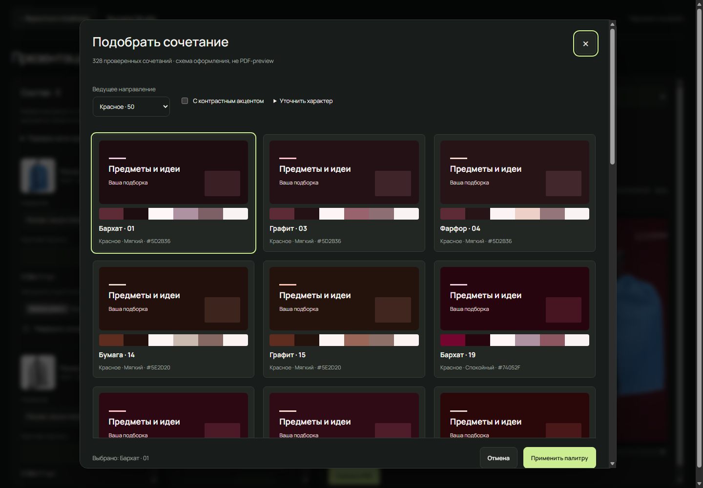
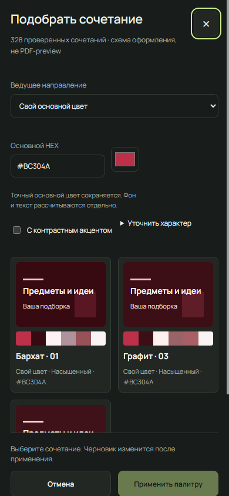
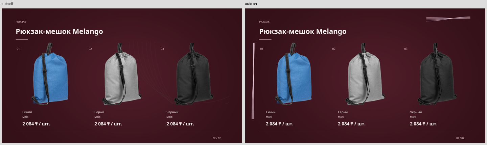

# Palette Explorer и автоматическое оформление

31 октября 2026. Реализовано в существующем редакторе и общем пути
`Collection → Snapshot → DesignPlan → ReportLab → PDFium`. Новых миграций,
очередей, внешних сервисов изображений и браузерных зависимостей нет.

Контроли: [красный Premium Dark](../apps/api/tests/fixtures/presentations/palette-explorer/red.pdf),
[смешанная подборка](../apps/api/tests/fixtures/presentations/palette-explorer/mixed.pdf),
[Editorial](../apps/api/tests/fixtures/presentations/palette-explorer/editorial.pdf),
[собственный HEX, скачанный в Edge](../apps/api/tests/fixtures/presentations/palette-explorer/custom-hex.pdf).
[Публичный manifest](../apps/api/tests/fixtures/presentations/palette-explorer/manifest.json)
содержит планы, роли, измерения, hashes страниц и фактические товарные данные;
cookies и приватных загрузок в нём нет.

## Библиотека и ведущий цвет

Из 2 376 локально рассчитанных кандидатов опубликованы **328**. Числа относятся
к версии 1 библиотеки, зафиксированной в
[library-v1.json](../apps/api/tests/fixtures/presentations/palette-explorer/library-v1.json).

| Направление | Сочетаний |
|---|---:|
| Красный | 50 |
| Оранжевый | 16 |
| Жёлтый | 38 |
| Зелёный | 34 |
| Бирюзовый | 29 |
| Голубой | 33 |
| Синий | 29 |
| Фиолетовый | 33 |
| Розовый | 34 |
| Коричневый | 8 |
| Нейтральный | 24 |

Удалены **94 точных** и **1 954 близких** дубля. Точная проверка учитывает набор
HEX без зависимости от перестановки. Близость считается глобально по RMS
евклидовых расстояний Oklab семи действительно используемых цветовых ролей;
порог 0,020. Это не CIEDE2000 и не доказательство художественного качества
каждого варианта. Малое коричневое направление — результат консервативного
исключения пересечений с другими направлениями.

Рецепты используют OKLCH, циклический hue и отдельную обработку низкой chroma.
Вне sRGB chroma уменьшается двоичным поиском; простое отсечение RGB не применяется.
Преобразование основано на опубликованных
[формулах Oklab](https://bottosson.github.io/posts/oklab/).
У нового Premium Dark hue ведущего цвета определяет тёмную основу и локальное
высветление. Старый сине-серый градиент остаётся только на совместимом старом пути.

`GET /api/presentations/palettes` возвращает по 24 записи, фильтры направления,
характера, применения и контрастного акцента. «Ещё сочетания» читает следующие
сочетания локальных рецептов, сохраняя выбор; после исчерпания кнопка отключается.
Это конечная библиотека, а не бесконечная AI-генерация. Собственный HEX создаёт
ограниченный набор согласованных рецептов с точным зафиксированным ведущим цветом.

Сервер сохраняет preset/origin, manual, edited_slots, точный primary, lock,
версию и все роли. Клиент не рассчитывает второй набор цветов: схема карточки
и PDF получают серверные значения. Поддельные роли из запроса заменяются
авторитетным расчётом. Ручное изменение даёт «Своя палитра», сохраняя происхождение.
Шесть полей относятся к ведущему цвету, тёмному/светлому фону, акценту, поверхности
и тексту. Редактируемое значение сохраняется; для контекстных ролей выводятся
безопасные оттенки. Зафиксированный primary при этом не подменяется.

## Диалог и сохранение

Диалог имеет ширину до 1100 px на desktop и занимает экран на mobile. Есть
явные «Применить» и «Отмена», загрузка дополнительных записей, ограниченный
кэш и отмена устаревших запросов. До применения настройки документа не меняются.
Просмотр, фильтры и отмена не вызывают Qwen, matting, импорт или PDF jobs.
Карточка явно обозначена как схема, не настоящий preview.

Применение сохраняет черновик. Генерация PDF остаётся отдельным действием.
Пока создаётся новая ревизия, старый preview виден с соответствующей подписью.
F5 восстанавливает настройки и выбранную существующую ревизию; выбор ревизии
хранится для конкретного документа и проверяется по ответу сервера.

## Декор и читаемость

В новых документах `auto_decoration` явно включён с интенсивностью SUBTLE.
Переключатель независим от AI. Варианты SUBTLE/NORMAL/BOLD задают ограниченное
число элементов и прозрачность; выключение сохраняет базовое оформление стиля.

Закрытая grammar версии 1 допускает contours, waves, grid, corners, ribbons,
dots. Детерминированный seed выбирает семейство и вариацию. Общие primitives
работают в измеренных свободных коридорах: исключаются реальные границы текста,
фото, логотипа и footer с дополнительным отступом. В result сохраняются разрешённые
области, фактические элементы и причины пропуска. При визуальной проверке
слишком яркие вытянутые контуры заменены открытыми плавными штрихами.

Приоритет определяется отдельно для каждой страницы по **фактическому размещению**
включённого COVER_PHOTO, BACKGROUND или DECORATION. Только логотип и выключенный
файл не отключают автоматические детали. Невместившийся обязательный материал
сохраняет NEEDS_REVIEW: download вернул **409**, approve — **422**; автоматический
декор не выдаётся за успешное размещение этого файла.

Контраст измеряется по всем различным цветам составного фона под каждым
измеренным текстовым блоком, включая градиент и пользовательские слои. Порог
4,5:1, либо 3:1 только для фактических 18 pt regular / 14 pt bold и крупнее,
согласно [критерию WCAG о контрасте](https://www.w3.org/WAI/WCAG22/Understanding/contrast-minimum.html).
При необходимости добавляется локальная защита текста. У всей библиотеки
минимальный проверенный контраст ролей **4,718:1**; у измеренных блоков финальной
контрольной выборки — **6,6129:1**. Это не сертификация доступности PDF целиком.
Фотографии товаров не перекрашиваются.

На новом пути ролей/автодекора также исключены прежние renderer-овалы за
поддерживающими предметами светлых стилей. Старые версии сохраняют свою геометрию.

## Версии и неизменность

`style_version=3` сохранён; palette/decor version=1 существуют отдельно.
Поля `palette_plan` и `auto_decoration`, отсутствующие в старых входах, остаются
NULL и включают прежний renderer. Новые роли не восстанавливаются из одного
preset ID на лету. Полные цвета, план, seed, подготовленные активы и фактическая
геометрия сохраняются в revision input/result. Повтор использует сохранённый план.

Три старых PDF V2 воспроизведены с прежними SHA-256, все **6 страниц** совпали
попиксельно. Старый Premium Dark V3 сохранил SHA-256
`5f0517fd5f5fd0ae952792b854414625f82a147a62e528c50f23744bb957d92d`.
Повторы сохранённых legacy-v3, auto-on и photo-cover дали те же PDF hashes.
Смена палитры/декора использует сохранённые фотографии и маски.

## Реальная приёмка

На основном PostgreSQL/API созданы два изолированных документа. Сохранены
**34 финальных контрольных ревизии**, всего **71 страница**; все финальные страницы
отрендерены PDFium и визуально просмотрены. Промежуточные исправленные рендеры
не включены в это число. Визуальная выборка палитр: **18 из опубликованных 328
и 1 собственная**, а не вся библиотека. Проверены шесть красных, дополнительные
синие, остальные направления, светлое и низконасыщенное нейтральное оформление.
Editorial и Modern Graphic дополнительно проверены на реальных двухстраничных PDF.

Контроль Melango: vto:1823109 / 1823108 / 1823107, синий/серый/чёрный,
Molti, **2084 ₸/шт.** по snapshot. Смешанный документ добавляет тонкие оранжевую
и белую ручки и бутылку FLOW. Их собственные фотографии и коммерческие значения
сохранены. Длинное русское название компании проверено на обложке.

| Сценарий | Фактический результат | Статус |
|---|---|---|
| Библиотека/направления/дубли/роли | 328, красных 50; полный числовой прогон | PASS |
| Ведущий красный и точный собственный HEX | Реальные красные PDF; #D6243B в API-контроле, #DB2344 в Edge | PASS |
| Авто off / on без файлов | Базовый стиль / открытые контуры, те же товары | PASS |
| Другой вариант | Waves и другая композиция, 3 страницы; товары и порядок сохранены | PASS |
| Только логотип | Автооформление присутствует | PASS |
| Фото только обложки | Авто пропущено на обложке, присутствует на товарной странице | PASS |
| Декор только PRODUCTS | Авто присутствует на обложке, пропущено на товарной странице | PASS |
| Выключенные файлы | Не блокируют авто | PASS |
| Невместимый required | NEEDS_REVIEW, HTTP 409/422 | PASS |
| Повтор, V2/V3, другие стили | Точные старые hashes/пиксели; новые роли в общем renderer | PASS |
| Ownership | Чужие document/PDF/preview — 404 | PASS |
| Сторонние черновики | Все 6 исходных fingerprints сохранены | PASS |
| Локальная Qwen | Недопустимый план, честный deterministic fallback | PARTIAL |

В установленном Edge выполнены desktop **1440×1000** и mobile **390×844**:
отмена, сохранение выбора при 24→30 карточках, собственный HEX, ручная правка
с происхождением, F5, auto off/on, старая картинка во время генерации, история,
реальное скачивание. Mobile без горизонтального overflow; Tab остаётся в native
dialog, Escape закрывает его. Подборка из трёх offer IDs сохранилась.
Скачанный браузером PDF совпал с ревизией:
`bb9dd952f838c2416b864de198fe9c24613bc36afc0c6a8da8d1fa25812cc64b`.

Один реальный сценарий AI занял **12,054 s** внутри планировщика. Полученный
план не прошёл validation (`INVALID_DESIGN_PLAN`); `ai_used=false`, PDF завершён
через fallback. Принятый live AI-план в этой итерации **не заявляется**.
Закрытая schema, lock цвета, сохранение порядка и fallback проверены регрессиями.

## Производительность

Открытие диалога в Edge **0,212 s**, дополнительные сочетания **0,217 s**.
Три HTTP-запроса библиотеки: **0,0213 / 0,0197 / 0,1644 s**.
Первое построение библиотеки и разрешение палитры вынесены из API event loop.
Холодный save с пятью параллельными health-пробами завершён за **1,177 s**;
health: **0,5261 / 0,3730 / 0,0555 / 0,0037 / 0,0047 s**.

Один snapshot и кэшированные фотографии; секунды:

| Контроль | Страниц | Assets | PDF | Preview | Всего | Байты | Peak RSS, MiB |
|---|---:|---:|---:|---:|---:|---:|---:|
| Auto off | 2 | .030 | 2.177 | .294 | 2.675 | 2 790 814 | 95,4 |
| Auto on | 2 | .036 | 2.177 | .165 | 2.555 | 2 790 013 | 93,1 |
| Другой вариант | 3 | .028 | 2.143 | .209 | 2.564 | 2 790 981 | 95,1 |
| Фото обложки | 2 | .033 | 2.317 | .312 | 2.839 | 2 916 143 | 105,6 |
| Смешанная подборка | 4 | 1.931 | 2.623 | .250 | 4.996 | 3 812 689 | 99,2 |
| AI с fallback | 2 | .028 | 2.130 | .159 | 14.543 | 2 792 068 | 96,9 |

Это smoke measurements, не p50/p95 и не доказательство ускорения auto on.
RSS относится к worker tree этих кэшированных запусков, без отдельного Ollama;
его нельзя приписывать только цветовой функции или холодному matting.

## Проверки, сохранность и очистка

| Проверка | Результат |
|---|---|
| Полный backend pytest | PASS: **449 passed, 1 opt-in deselected**, 178,03 s |
| Frontend component/state tests | PASS: **23** |
| Ruff / ESLint / TypeScript | PASS |
| Next.js production build | PASS; финальная сборка запущена на frontend |
| Skill validation / git diff --check | PASS |
| Основной HTTP/PostgreSQL и ownership | PASS |
| Desktop/mobile Edge, настоящее скачивание | PASS |
| Все 71 финальные страницы / hashes четырёх сохранённых PDF и preview | PASS |
| Старые V2/V3 и повтор замороженных входов | PASS |

Постоянные регрессии:
`test_palette_decoration.py`, `presentation-palettes.test.cjs`;
постоянная приёмка: `scripts/check_palette_decoration.py` и
`scripts/check_palette_browser.py`. Общий fixture библиотеки читается обеими
сторонами, без дублирования цветового алгоритма.

Основная PostgreSQL не сбрасывалась. До/после HTTP-приёмки — **4495 SupplierOffer**.
Код задачи не меняет каталог, observations, jobs или checkpoints. Существующий
VTO job на снимке PENDING / TEMPORARILY_UNAVAILABLE, page 23; его собственный
backoff не относится к палитрам. Импорт может продолжать работу независимо,
поэтому сохранность каталога не объявляется по неизменному числу строк навсегда.
Все шесть исходных черновиков имеют прежние fingerprints.

Cleanup **PASS**: по записанным точным IDs удалены 2 disposable-пользователя,
2 проекта, 2 документа и все их промежуточные/финальные ревизии. SQL подтвердил
ноль соответствующих users/projects/documents/revisions/auth sessions и прежние
fingerprints остальных шести черновиков. Удалены task-owned render directories,
ledger/cookies, probes, одноразовый скрипт сборки доказательств, временный профиль
Edge и логи остановленных тестовых процессов. Постоянные scripts/tests/эталоны,
управляемый кэш реальных фото, пользовательские материалы и активные service logs
сохранены. Старые ресурсы других задач не удалялись.

После очистки API, frontend, frontend health proxy и Ollama вернули **HTTP 200**.
PostgreSQL, Ollama, API и frontend остаются запущенными; task-owned CDP listener
9226 закрыт. Результат exact-ID проверки сохранён в публичном manifest.

**NOT TESTED:** длительная нагрузка/p95, другие браузеры, screen reader и полная
PDF-accessibility; визуальный просмотр всех 328 сочетаний. Все сочетания прошли
числовую проверку, художественная приёмка ограничена описанной выборкой.
Отдельный успешный live AI-план остаётся непроверенным. Новые маски не исправляют
известные дефекты исходных белых/стеклянных изображений.
