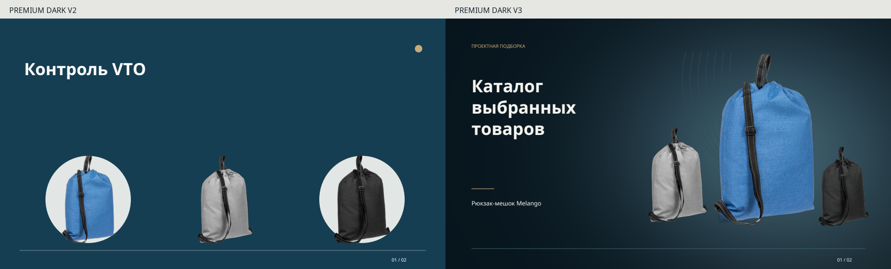
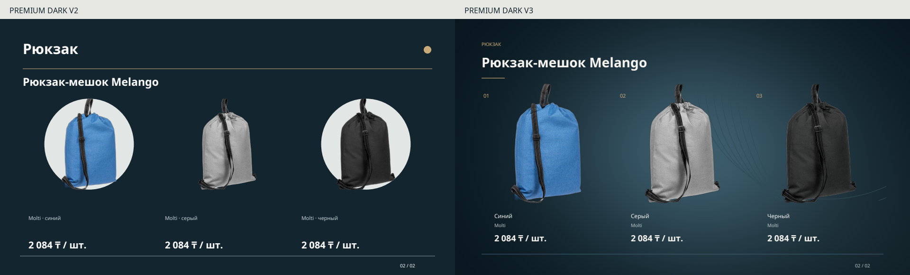

# Premium Dark 3 — визуальная доработка

Расширение редактора пользовательскими фото, текстурами и орнаментами:
[Свои материалы — приёмка и совместимость](custom-presentation-assets.md).
Описанный ниже исходный контроль Premium Dark 3 сохранён побайтово.

30 октября 2026. Обновлены обложка и сравнительная страница существующего
Premium Dark. Проектная подборка, редактор, импорт, snapshots и очередь сохранены.

[Контрольный PDF](../apps/api/tests/fixtures/presentations/premium-dark-v3/premium-dark.pdf)
· [Обложка](../apps/api/tests/fixtures/presentations/premium-dark-v3/cover.png)
· [Товарная страница](../apps/api/tests/fixtures/presentations/premium-dark-v3/variants.png)
· [Публичный manifest](../apps/api/tests/fixtures/presentations/premium-dark-v3/manifest.json)

## Визуальный источник и исходное состояние

Изображение референса рассмотрено в сообщении пользователя: глубокий фон,
локальный свет, крупные предметы, сдержанная нумерация, компактные товарные блоки.
Поиск в текущей папке вложения `80dba781-a744-4e7e-bba2-7979d58a6203` и дереве
attachments нашёл только текст, без файла изображения. Поэтому открытие
локального оригинала и pixel comparison с ним **не заявляются**. Чужие логотипы,
архитектурная фотография и фирменные элементы не использованы.

Все страницы исходных `premium-dark.pdf`, `editorial.pdf` и `modern-graphic.pdf`
Design V2 отрендерены PDFium и просмотрены как изображения.

Наблюдения до изменения:

- Обложка повторяла ряд из трёх небольших предметов; над ними оставалось много
  пустого пространства без композиционной функции.
- За синим и чёрным Melango были непрозрачные светлые овалы. Их создавал
  `PagePainter.object`: `ellipse` при средней яркости фотографии ниже порога.
  Это проверено по коду и фактическим PNG: овалы не являются частью фотографий.
- «Рюкзак» и «Рюкзак-мешок Melango» конкурировали как два крупных заголовка.
- Видимая высота рюкзаков была около 195 pt, до подписей и цен оставались разрывы.

## Что изменилось

Палитра прежняя: **#163E52 / #C9AB78**. Процедурное освещение состоит из
глубокой основы и мягкого локального высветления. Редкие контурные дуги
ограничены областью фотографий; под названиями и ценами узора нет. Шум,
новые шрифты, внешние сервисы и искусственные световые контуры не добавлены.
Светлая клиентская палитра сначала переводится в тёмную фоновую роль; отдельные
проверки белой, серой и светло-синей палитр подтверждают читаемость текста.

Обложка получила самостоятельную иерархию: текст слева, ведущий предмет справа,
меньшие варианты поддерживают его. Без компании используется нейтральное
«Каталог выбранных товаров». «Контроль VTO» не является текстом шаблона.
На сравнении слева сохранён исходный V2 с его тестовым именем, справа показан
нейтральный вариант нового шаблона без компании.

На товарной странице категория стала небольшим указателем; модель — единственным
основным заголовком. Три предмета имеют одинаковую видимую высоту около **252 pt**:
примерно на **30%** больше. Масштаб считается по непустому alpha bounds, с сохранением
всех ненулевых alpha-пикселей. Пропорции, ремни и ручки не обрезаются.
Цвет, бренд и цена собраны непосредственно под своей фотографией. Цена — 18 pt,
модель — 28 pt; длинный заголовок переносится с уменьшением поля фотографий.
Изображения не перекрашиваются, подготовленные активы не переписываются.

## Версии, данные и проверка

Используется прежний общий путь `Snapshot → DesignPlan → ReportLab → PDFium`.
В общем painter добавлена ветка Premium Dark версии 3, общий photo получил
оптическое размещение, caption — компактную группу. Рендеры трёх стилей не дублируются.

Новые генерации Premium Dark получают `style_version=3`. Старые revision inputs,
планы, PDF и повтор неудавшейся старой ревизии сохраняют версию 2. Повторное
воспроизведение **всех трёх PDF V2** на прежних данных дало исходные SHA-256;
все шесть страниц также попиксельно совпали. Editorial и Modern Graphic не изменены.

Контроль содержит `vto:1823109`, `vto:1823108`, `vto:1823107`: синий, серый,
чёрный Melango, Molti, по **2084 ₸ / шт.** на момент snapshot. Те же фотографии
из кэша воспроизводят исходные PDF V2; hashes источников/PNG сохранены в manifest.

На основном HTTP API в изолированном проекте выполнены выбор, создание документа,
сохранение настроек, генерация, чтение persisted input/plan, preview, подтверждение
просмотренных масок и авторизованное скачивание. PDF и оба preview совпали с
локально просмотренным контролем. Итоговый PDF: **2 страницы, 2 823 039 bytes**,
SHA-256 `5f0517fd5f5fd0ae952792b854414625f82a147a62e528c50f23744bb957d92d`.

Последний прогон после перезапуска API: assets **0.775 s**, PDF **1.055 s**,
preview **0.173 s**, всего **2.189 s**. Первый HTTP-прогон занял **2.329 s**;
оба дали один и тот же PDF. AI отключён; вызовов Qwen не было. Лимиты и число retries
не увеличены. При включённом AI версия фиксируется в закрытой decoding schema;
это проверено регрессией с одним вызовом. Это smoke timing, не нагрузочный p95.

| Проверка | Результат |
|---|---|
| Контрольные две страницы Melango, читаемость, ремни, подписи, цены | PASS: просмотрены реальные PDFium-рендеры и сравнения |
| Узкая бутылка, длинная русская подпись ручки, три разные модели рюкзаков, logo on/off | PASS для размещения и данных; просмотрены итоговые страницы |
| Белое изделие и стекло | Layout PASS; качество отдельных существующих масок PARTIAL, см. ниже |
| Все финальные страницы ограниченной контрольной выборки | Просмотрены 16 страниц семи документов |
| Основной HTTP API, persisted version, preview/PDF identity | PASS |
| Старые V2 / Editorial / Modern Graphic | PASS: прежние PDF hashes и пиксели |
| Полный backend pytest | PASS: 410 passed, 1 opt-in deselected; 198.14 s |
| Финальные render/design/API-регрессии после ограничения яркости светлой палитры | PASS: 51; 10.14 s; контрольный PDF не изменился |
| Ruff, skill validation | PASS |
| git diff --check | PASS |
| Frontend build/lint и новый браузерный сценарий | NOT RUN в этой итерации: UI не менялся |
| Локальный оригинал референса / pixel comparison с ним | NOT AVAILABLE; визуальный источник — inline изображение |

Новые постоянные регрессии проверяют границы alpha и сохранение белых/слабых
пикселей, отсутствие renderer-овала V3, воспроизведение V2/V3, коммерческие поля,
отсутствующую цену, длинную компанию/подзаголовок, logo on/off, миграцию версии
только новой генерации и закрытую версию AI-плана.

## Ограничения активов и сохранность

На других товарах выявлены проблемы уже существующего локального matting:

- Kentucky `vto:1957351`: светлая непрозрачная область между корпусом и ремнём.
- Стеклянная Bailey `vto:1948520`: неточная прозрачность стекла и крышки меняет
  их восприятие на тёмном фоне. Это не новое перекрашивание renderer.

[Сопоставление оригинала и маски](../apps/api/tests/fixtures/presentations/premium-dark-v3/source-vs-mask.png)
сохранено как доказательство. Эти активы требуют отдельной проверки/подготовки
или другого фото того же варианта; световая область их не исправляет. Они не
входят в итоговый контроль Melango и не объявляются качественно вырезанными.

Основная БД, проектные подборки, пользовательские документы, логотипы и кэш
подготовленных фото не сбрасывались. Миграций в этой итерации нет. На HTTP-проверке
до/после осталось **4371 offer** с тем же offer/observation fingerprint
`b64e9d7dfb7cc8b653d9389f8cd6e4dc`. VTO jobs/checkpoints не изменялись кодом задачи.
Очистка ограничена точными disposable IDs и доказанными временными папками;
контрольные PDF/PNG/manifest и постоянные тесты сохранены.

Очистка выполнена: `premium-v3-*` аккаунтов осталось 0, временные папки рендеров
и probes удалены. После очистки основной API, frontend и его health proxy
вернули HTTP 200. PostgreSQL, Ollama, API и frontend остаются запущенными.
