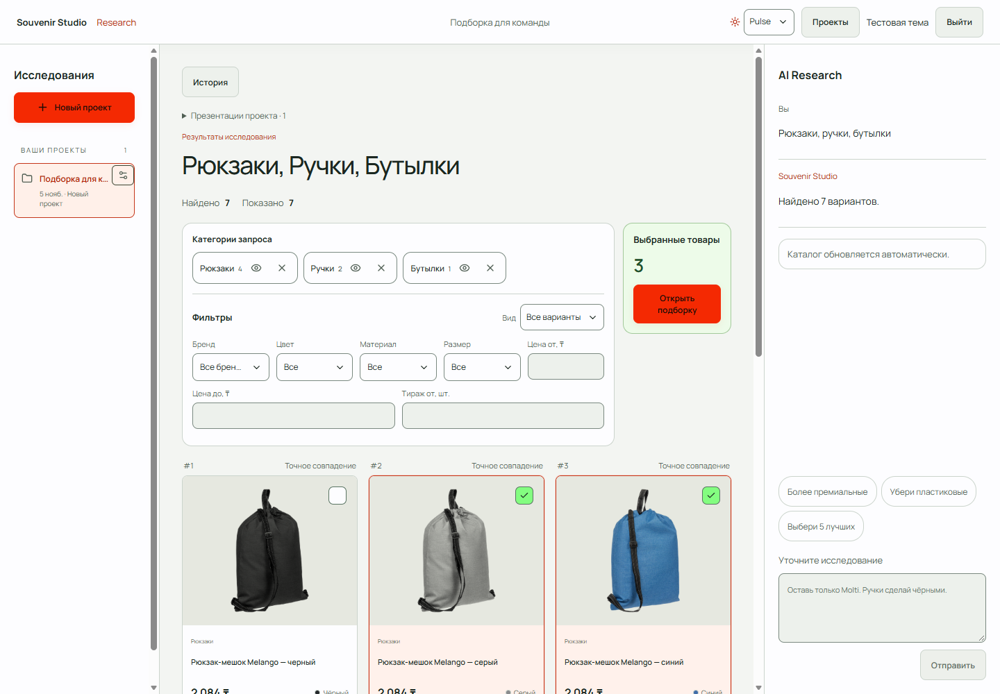

# Дополнительная тема Pulse

5 ноября 2026. **Тема — PASS. Общая приёмка — PARTIAL:** отдельно обнаружен
существующий дефект выхода из аккаунта, описанный ниже. Основной интерфейс
сохранил прежнюю тёмную тему по умолчанию; Pulse выбирается явно.

## Переключение и сохранение

В шапке workspace, редактора презентаций и формы входа появился select
**«Тема интерфейса» → «Текущая» / «Pulse»**. Переключение происходит сразу,
без перезагрузки и запроса к backend.

Предпочтение хранится в `localStorage['souvenir:site-theme']`, отдельно от
workspace, проекта и документа. Оно сохраняется после F5 и нового входа в том
же браузере; две открытые вкладки согласуются через `storage` event. Серверного
профиля темы и синхронизации между устройствами нет. Если storage недоступен,
переключение работает на текущей странице, а новая загрузка использует текущую тему.

Статический скрипт в `<head>` устанавливает `data-site-theme` до первого
отображения интерфейса. Принимаются только `current` и `pulse`. Общий control
использует React `useSyncExternalStore` со стабильным серверным значением:
hydration сохраняет согласованный DOM. `suppressHydrationWarning` ограничен узлом
`<html>`, чей атрибут меняет ранний скрипт; он не применяется ко всему дереву UI.

## Цветовая система

| Роль | Pulse |
|---|---|
| Основной акцент /CTA | `#f42902` |
| Карточки, панели, диалоги | `#FDFDFF` |
| Success /выбор | `#83FD80`, мягкая подложка `#edfbe9` |
| Фон страницы | `#f3f5f2` |
| Основной /вторичный текст | `#1b2720` /`#4f5e53` |
| Акцентный текст, ссылки, focus | Тёмные производные красного, включая `#b52308` |
| Warning /error | `#805000` /`#ae2821` с отдельными мягкими подложками |

Цвета собраны в семантические переменные `themes.css`: поверхности, тексты,
контролы, границы, выбор, focus, disabled, overlay и popover. Цветовые литералы
основных старых компонентов получили переменные с **исходными fallback-значениями**:
текущая тема сохраняет прежние цвета. Второй набор layout-стилей не копировался.

На основном CTA тёмный текст: светлый на `#f42902` давал бы только около 4:1.
В браузере измерено 4.73:1 для CTA, 5.61:1 при hover, 5.25:1 при нажатии;
минимум среди 14 контрольных измерений — **4.58:1**. Открытые варианты palette
listbox: 15.23:1, активный вариант: 9.16:1. Disabled имеет собственные цвета.

Цвета фотографий, логотипов, palette swatches и PDF-планов остаются данными
товара/документа. Site theme не записывается в настройки презентации и не
перегенерирует PDF. Layout, действия поиска и модель коллекции не изменялись.

## Изменённые файлы

- [themes.css](../apps/web/src/app/themes.css): Pulse, semantic roles, состояния и control.
- [site-theme.ts](../apps/web/src/lib/site-theme.ts): storage, подписка вкладок, ранняя инициализация.
- [theme-switch.tsx](../apps/web/src/components/theme-switch.tsx): общий доступный native select.
- [layout.tsx](../apps/web/src/app/layout.tsx): stylesheet, bootstrap и атрибут темы.
- `auth-gate.tsx`, `research-workspace.tsx`, `presentation-workspace.tsx`: размещение control.
- `globals.css`, `studio.css`, `research.css`, `presentation.css`: семантические цвета с прежними fallback.
- [site-theme.test.cjs](../apps/web/tests/site-theme.test.cjs): четыре постоянные проверки store/bootstrap.
- [check_site_theme.py](../scripts/check_site_theme.py): повторяемая проверка в установленном Edge.

Новые зависимости, миграции и изменения backend не добавлялись. Предыдущие
незакоммиченные изменения проекта сохранены.

## Проверки

| Проверка | Результат |
|---|---|
| Frontend Node tests | PASS: 36, включая четыре новых |
| ESLint /TypeScript /Next production build | PASS |
| Ruff нового harness /git diff --check | PASS |
| Edge desktop 1440×1000 /mobile 390×844 | PASS: 45 проверок темы |
| Контраст normal/hover/pressed/disabled/error и dropdown | PASS: 14 измерений, все ≥4.5:1 |
| F5, два настоящих tab, новый вход, сохранение workspace/selection | PASS |
| Применение Pulse до hydration | PASS: external JS bundles блокировались; SSR loading screen уже имел Pulse |
| Авторизация, карточки, HUD, фильтры, empty, selected modal, details | PASS в отдельном тестовом каталоге |
| Editor, открытые desktop/mobile palette listbox, Escape, отмена | PASS |
| Неизменность collection и snapshot при смене темы/просмотре палитр | PASS: полное сравнение серверных данных |
| Основная PostgreSQL, реальные пользовательские проекты | Не использовались и не изменялись |
| Полный backend suite, другие браузеры, реальные iOS/Android, screen reader | NOT RUN /NOT TESTED в этой frontend-итерации |
| Генерация и визуальная проверка новых PDF | NOT RUN: renderer и PDF-дизайн не менялись |

Проверялся production frontend с настоящим существующим backend API на отдельной
одноразовой SQLite. В каталоге семь вариантов: четыре Melango из сохранённого
VTO fixture и три явно обозначенных тестовых товара. Три фотографии соответствуют
своим variant IDs и проверены по SHA-256 существующего кэша; остальные намеренно
без фото. Это визуальные fixtures, не актуальные цены/остатки рабочего VTO.
Публичные сайты не обходились, Ollama и основной PostgreSQL не запускались.

В ходе проверки исправлены специфичность стилей переключателя внутри auth form
и перекрытие disabled-цветов primary CTA. Промежуточные скриншоты переходов тем
не использованы как эталоны: финальные сняты после завершения CSS transitions.

Машиночитаемое доказательство: [acceptance.json](screenshots/site-theme/acceptance.json).

## Отдельный существующий дефект

**FAIL вне темы:** `POST /api/auth/logout` с `Content-Type: application/json` и
пустым телом возвращает **400 `INVALID_JSON`**. Frontend уже отправляет такой
запрос; middleware пытается разобрать отсутствующее JSON-тело. Дефект воспроизведён
прямым HTTP в тестовом контуре, где theme code не участвует.

Auth/API не исправлялись в этой визуальной задаче. Проверка нового входа выполнена
после очистки cookies только тестового профиля Edge; localStorage и тема сохранились.
Успешный logout не заявляется.

## Скриншоты

Все контрольные изображения просмотрены. Desktop/mobile не имеют горизонтального
overflow; открытый palette popover помещается в viewport.



| Экран | Контроль |
|---|---|
| Текущая тёмная тема | [Desktop](screenshots/site-theme/current-grid-desktop.png) |
| Pulse на телефоне | [Сетка](screenshots/site-theme/pulse-grid-mobile.png), [вход](screenshots/site-theme/pulse-auth-mobile.png) |
| Авторизация и error/focus | [Desktop](screenshots/site-theme/pulse-auth.png) |
| Выбранные товары и детали | [Подборка](screenshots/site-theme/pulse-selected.png), [карточка](screenshots/site-theme/pulse-product-details.png) |
| Фильтры и пустая выдача | [Mobile filters](screenshots/site-theme/pulse-filters-mobile.png), [empty](screenshots/site-theme/pulse-empty.png) |
| Редактор презентации | [Editor](screenshots/site-theme/pulse-editor.png) |
| Открытый dropdown палитр | [Desktop](screenshots/site-theme/pulse-palette-dropdown.png), [mobile](screenshots/site-theme/pulse-palette-mobile.png) |

## Воспроизведение и очистка

После `npm run build` в `apps/web` из корня проекта:

```powershell
.\.venv\Scripts\python.exe -B -X utf8 scripts/check_site_theme.py
```

Нужны установленный Edge и записанные source photos из существующего presentation
cache. Harness проверяет свободные порты 3000/18012/18013/9226 до запуска, создаёт
собственный профиль и БД, сохраняет screenshots/JSON, затем удаляет только свою
временную папку и останавливает свои процессы. Основные сервисы после проверки
остаются **остановленными**, как до начала задания. Контрольные изображения,
регрессии и отчёт сохранены; debug screenshot удалён.
