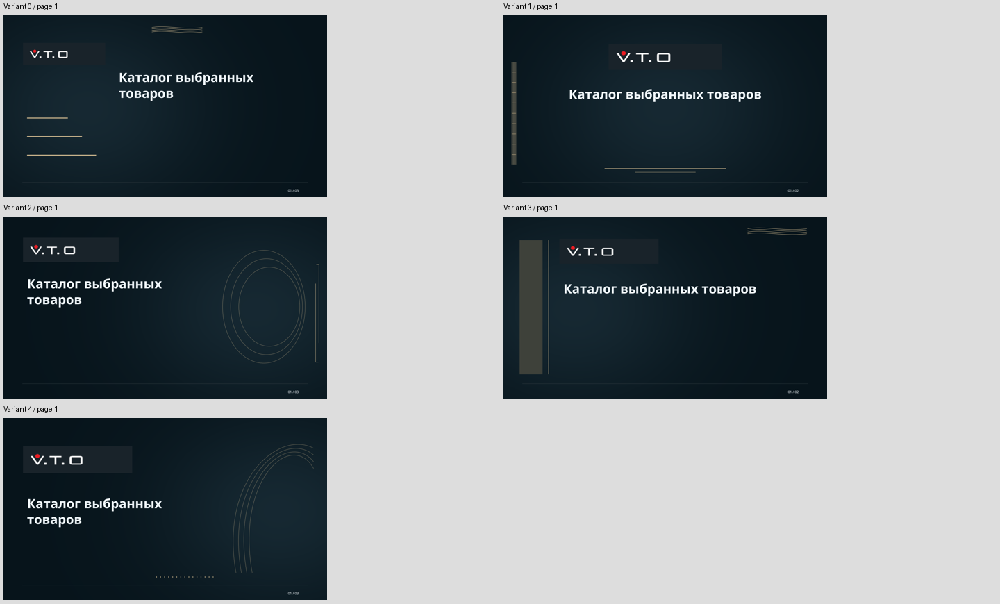
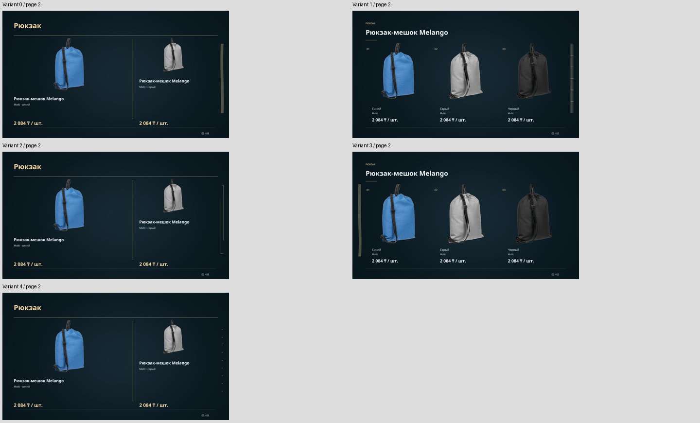

# Dropdown палитры, титульный лист и варианты оформления

31 октября 2026. Изменён существующий редактор Souvenir Studio и общий путь
`Collection → Snapshot → DesignPlan → ReportLab → PDFium`. Библиотека из 328
палитр, поиск, коллекции, VTO и подготовка товарных масок сохранены.

Эталоны: [вариант 1](../apps/api/tests/fixtures/presentations/title-cover-v1/variant-0.pdf),
[2](../apps/api/tests/fixtures/presentations/title-cover-v1/variant-1.pdf),
[3](../apps/api/tests/fixtures/presentations/title-cover-v1/variant-2.pdf),
[4](../apps/api/tests/fixtures/presentations/title-cover-v1/variant-3.pdf),
[5](../apps/api/tests/fixtures/presentations/title-cover-v1/variant-4.pdf),
[клиентский логотип](../apps/api/tests/fixtures/presentations/title-cover-v1/custom-active.pdf),
[свои фоновые материалы](../apps/api/tests/fixtures/presentations/title-cover-v1/custom-art.pdf).
В [manifest](../apps/api/tests/fixtures/presentations/title-cover-v1/manifest.json)
сохранены реальные планы, подписи геометрии, hashes, метрики и товарные факты.
Приватных cookies или корпоративных загрузок в эталонах нет.

## Причина и исправление dropdown

Все три прежних списка были native select: направление, характер, применение.
У фильтров задавались `background:var(--bg)` и светлый `color:var(--text)`;
совместимые цвета раскрытого системного popup и `color-scheme` не задавались.
В Windows светлая поверхность native menu могла сочетаться с унаследованным
светлым текстом. Пункты направлений действительно не были disabled.

В проекте не было общего доступного Select для такого диалога. Добавлен один
`PaletteSelect` для всех трёх фильтров. Он сохраняет значения и API-фильтрацию;
цветовая библиотека не переделывалась. Select-only combobox использует
`aria-controls`, `aria-expanded`, `aria-activedescendant`, именованный listbox,
выбранный пункт с галочкой и отдельное состояние active/hover. Клавиатура:
стрелки, Home/End, PageUp/PageDown, typeahead, Enter/Space, Tab и Escape.
Паттерн согласован с [WAI-ARIA APG](https://www.w3.org/WAI/ARIA/apg/patterns/combobox/examples/combobox-select-only/).

Popup находится внутри DOM модального dialog, использует native popover top
layer и вычисляемые границы viewport. Portal, огромный z-index и глобальные
стили форм не применяются. Есть собственная прокрутка. Первое Escape закрывает
только список; фокус остаётся на combobox. Tab закрывает список и продолжает
переход внутри диалога. CSS явно задаёт совместимые тёмный фон и светлый текст,
без opacity для доступных пунктов. Общий компонент поддерживает реальные
disabled-пункты и пустой список; в текущих трёх фильтрах недоступных пунктов нет.

В установленном Edge проверены **все три раскрытых списка**, normal/selected/
active/hover, прокрутка, клавиатура, отмена/применение, F5. Минимальный измеренный
контраст текста доступных пунктов — **9,492:1**. Снимки: [направление](../apps/api/tests/fixtures/presentations/title-cover-v1/dropdown-0.png),
[характер](../apps/api/tests/fixtures/presentations/title-cover-v1/dropdown-1.png),
[применение](../apps/api/tests/fixtures/presentations/title-cover-v1/dropdown-2.png),
[mobile viewport](../apps/api/tests/fixtures/presentations/title-cover-v1/dropdown-mobile.png).
Это проверка читаемости, а не сертификация доступности приложения.

## Обязательный титул новых генераций

Новые явные генерации, включая генерацию старого черновика, получают
`cover_policy=1`, `DesignPlan.schema_version=2`, `renderer_version=1`.
Версия Premium Dark остаётся `style_version=3`; палитра/декор имеют свои версии.
Старые входы без новой cover-policy сохраняют прежний путь рендера.

Первая страница имеет `layout=title`, пустой `product_refs`, выбранные
`title_family` и `logo_ref`. Правило проверяется генератором, серверным
валидатором и renderer. На TITLE не вызываются товарные photo/caption/price
компоненты; их фактический trace сохранён в результатах. Названия моделей,
цены, товары и каталоговые силуэты на титул не переносятся. Все варианты
snapshot присутствуют в товарной части начиная со второй страницы.

Настройка «Добавить обложку» убрана: она не может отключить новый титул.
Поле названия презентации не возвращалось. Заголовок берётся из компании
(«Подборка для …») или нейтрального «Каталог выбранных товаров»; подзаголовок
остаётся пользовательским. Титул заменяет старую товарную обложку.

Свои BACKGROUND/COVER_PHOTO/DECORATION сохраняют scope. Для TITLE допустимы
только собственные не-каталоговые материалы; фотографическая область выбирается
с учётом измеренных текста/логотипа. На финальном контроле фото архитектуры
и декор применены на странице 1, выбранных товаров там нет. Архитектура —
существующая синтетическая fixture, не реальное корпоративное фото. Текстовая
модель не определяет содержимое произвольного пользовательского изображения.
Визуальная проверка обложки остаётся обязательной.

## Реальный 251.png и выбор логотипа

Оригинал найден в корне: **`251.png`**, 251×30 px, PNG с палитрой и tRNS alpha.
Файл визуально просмотрен: проектный VTO. SHA-256:
`ede89826aed478c55b79cef412ae06a566d13c75d6a9bdfdbe5ea43b0b6ad290`.
Точная копия зарегистрирована в **`apps/api/app/assets/presentations/251.png`**
и включена в setuptools package-data. Worker читает backend asset, без
абсолютного пользовательского пути и зависимости от frontend server.

Приоритет: валидный активный клиентский логотип; иначе настоящий проектный
VTO, включая выключенный клиентский. На титуле ровно один выбранный логотип.
Отдельная подпись UI объясняет default, checkbox теперь означает использование
загруженного клиентского файла. При отсутствии upload он недоступен.

До постановки новой ревизии логотип проверяется вне DB lock и копируется в
неизменяемый hash-addressed storage. Snapshot сохраняет source default/custom,
asset_id, внутренний key, hash, размеры и preparation_version=1. Публикация
полного файла атомарна и не заменяет уже читаемый файл на Windows. Renderer
проверяет замороженный hash. Будущая замена приложения не меняет старые bytes.
Цвета и alpha не инвертируются; подложка адаптируется к логотипу. Прозрачные
пустые поля оптически убираются без удаления видимых пикселей.

Повреждённый активный клиентский файл даёт **HTTP 422 и видимую ошибку в редакторе**.
На VTO он не подменяется. Предыдущий корректный логотип/PDF остаётся в storage.
В приёмке временно повреждался только upload собственного тестового документа,
после проверки файл восстановлен. [Фактическая ошибка UI](../apps/api/tests/fixtures/presentations/title-cover-v1/broken-logo-visible.png).

## Композиции, идемпотентность и повтор

Пять семейств титула используют общие text/logo/graphic primitives: open,
centered, split, band, arch. Различаются положение и выравнивание заголовка,
геометрия логотипа, крупная графика и световое поле. Товарные страницы используют
те же hero/asymmetric/category/variants/lineup компоненты; добавлены управляемое
зеркальное размещение hero и поднятый triptych. Лишних пустых страниц нет.

Новая явная генерация из UI получает request UUID. Повтор того же HTTP key,
включая двойной клик, возвращает ту же ревизию. Следующий явный запрос после
завершения получает новый key, seed и при необходимости source version.
Новые API-клиенты передают `request_id`; старые вызовы без него сохраняют
совместимую идемпотентность по версии. Retry FAILED с прежним key возобновляет
ту же ревизию с замороженными входом, логотипом и планом. Скачивание/F5/история
ничего не генерируют. Сохранение полей и просмотр палитр также не создают jobs.

Seed выделяется один раз под существующими locks. Сравниваются геометрические
признаки с **тремя** недавними планами этого документа; бюджет — до 10 кандидатов.
Подпись исключает seed, UUID, дату, товарные IDs и логотипный hash. Неиспользуемый
параметр variant также не считается изменением. Проверяются реальные геометрии
титула и используемые профили товарных компонентов. Цель — минимум два заметных
изменения. При исчерпании безопасных вариантов result/UI сообщают CONSTRAINED.
AI не нужен для разнообразия; отклонённый план не запускает бесконечную генерацию.

## Пять последовательных финальных вариантов

Один snapshot: vto:1823109, vto:1823108, vto:1823107; Melango, Molti,
синий/серый/чёрный, **2084 ₸/шт.** в каждом snapshot. Стиль Premium Dark,
палитра `#163E52 / #C9AB78` одна и та же. Все коммерческие факты, порядок,
source/mask hashes совпали во всех финальных контролях.

| Вариант | Семейство | Seed | Страниц | Минимум изменений против последних 3 | Всего, s | Байты | RSS, MiB |
|---|---|---:|---:|---:|---:|---:|---:|
| 1 | Open | 19 | 3 | 4 | 1.952 | 2 791 479 | 90,7 |
| 2 | Centered | 20 | 2 | 5 | 1.924 | 2 791 470 | 90,0 |
| 3 | Split | 21 | 3 | 4 | 2.064 | 2 791 583 | 96,9 |
| 4 | Band | 22 | 2 | 4 | 2.031 | 2 790 418 | 93,4 |
| 5 | Arch | 23 | 3 | 3 | 1.963 | 2 792 527 | 92,1 |

Seeds продолжают историю изолированного документа, а не подогнаны к пяти
примерам. Измерения относятся к кэшированным фото и worker tree, не к отдельному
Ollama или холодному matting. Это smoke measurements, не нагрузочный p95.

## Реальная приёмка и совместимость

Выполнены **14 финальных контрольных сценариев / 13 различных ревизий**, всего
**36 просмотренных PDFium-страниц**, включая повтор той же ревизии. Просмотрены
все страницы, а не только извлечённый текст. Trace каждой TITLE содержит один
title_logo и ни одного product-компонента. Preview и авторизованные скачивания
совпали с сохранёнными hashes.

| Проверка | Результат |
|---|---|
| Нет клиентского логотипа / пустые компания и подзаголовок | PASS: полноценный нейтральный титул, default VTO |
| Активный клиентский логотип | PASS: только синтетический SS, без VTO |
| Клиентский выключен | PASS: VTO |
| Активный повреждён | PASS: HTTP 422, видимая ошибка, без подмены |
| Длинная компания / свои фото и декор | PASS: измеренные переносы, TITLE без выбранных товаров |
| Пять последовательных оформлений | PASS: пять разных fingerprints и видимая композиция |
| Двойной HTTP / контролируемый FAILED retry | PASS: один ID; retry сохранил input, план и PDF |
| Два параллельных документа разных пользователей | PASS: собственные logo/seed/plan; чужой документ 404 |
| Новая замороженная ревизия | PASS: одинаковые plan/signature/logo/PDF при повторном рендере |
| Старые V2 Editorial / Premium Dark / Modern Graphic и V3 | PASS: прежние hashes, все 8 страниц попиксельно идентичны |
| Edge desktop 1440×1000 / 390×844 viewport | PASS: открытые dropdown, клавиатура, F5, история и скачивание |

В Edge отдельно проверены сохранение старого preview во время генерации,
новая явная генерация после завершённой, восстановление выбранной исторической
ревизии после F5 и настоящее скачивание. SHA-256 скачанного контрольного PDF:
`933fb90e31d8de480a1ff48544e87c7e091911119e9e77c7cfe113a2adfed324`.

Первые проверки обнаружили исправленную Windows-гонку hash-file publication.
Старый тест материалов сравнивал разные явные генерации, которые теперь
преднамеренно различаются: он обновлён на сравнение disabled/no-art на одном
замороженном плане. В приёмочном harness исправлены scope/crop для декора,
ожидание commit состояния combobox, выбор локальной вкладки Edge и полная
перезагрузка при смене тестового аккаунта. Эти промежуточные ошибки не выданы
за успешную финальную проверку.

| Quality gate | Результат |
|---|---|
| Полный backend pytest | PASS: **457 passed, 1 opt-in deselected**, 192,65 s |
| Frontend component/state tests | PASS: **24** |
| Ruff / ESLint / TypeScript | PASS |
| Next.js production build | PASS; финальная сборка работает на frontend |
| Presentation skill validation / git diff --check | PASS |
| Основной HTTP/PostgreSQL, Edge и все финальные страницы | PASS |

Постоянные тесты: `test_title_variation.py`, обновлённые material/palette tests;
приёмка: `check_title_variation.py`, `check_title_browser.py`.

Cleanup **PASS**: удалены только два записанных disposable-аккаунта, два проекта,
два документа и все принадлежащие им ревизии/файлы, включая промежуточные рендеры.
SQL подтвердил 0 соответствующих users/projects/documents/revisions/auth sessions.
Fingerprints всех **7** других черновиков совпали. До/после — **4495 offers**;
каталог, observations, коллекции реальных пользователей, jobs/checkpoints и
основная PostgreSQL не сбрасывались. Исходный `251.png`, его application-копия,
управляемый кэш, пользовательские документы и старые эталоны сохранены.

Временный Edge закрыт штатно, listener 9226 закрыт, его task-owned профиль удалён.
Ledger/cookies, временные screenshots/render directories и тестовые логи удалены
после переноса доказательств в постоянные fixtures. Общий helper приёмки теперь
обрабатывает DELETE 204 и повтор cleanup после частичного завершения. Активные
service logs сохранены. PostgreSQL, Ollama, API и frontend остаются запущенными.

**NOT TESTED:** Safari, Firefox, реальная mobile OS, screen reader, длительная
нагрузка/p95. Live Qwen с новым TITLE не вызывалась; ни одного успешного AI-плана
этому запуску не приписывается. Детерминированный путь, validation и fallback
остаются рабочими. Проектный Chromium runtime не устанавливался.
